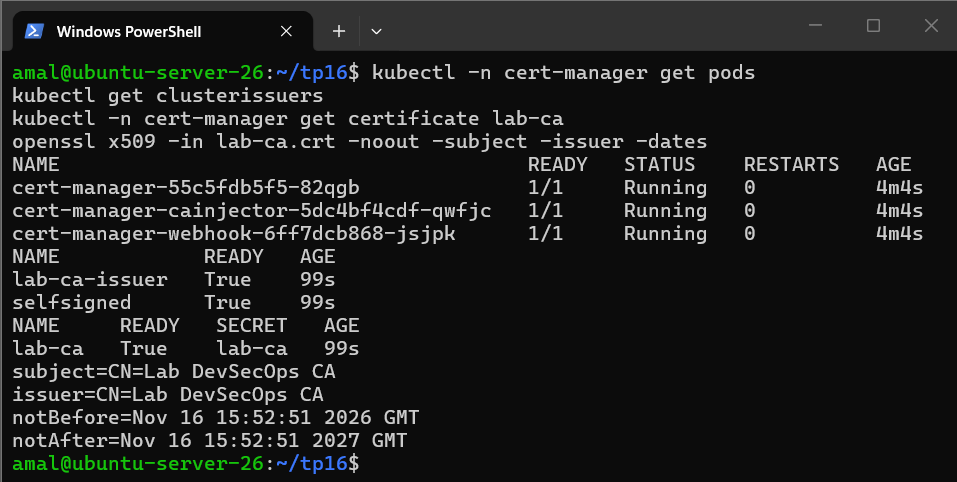
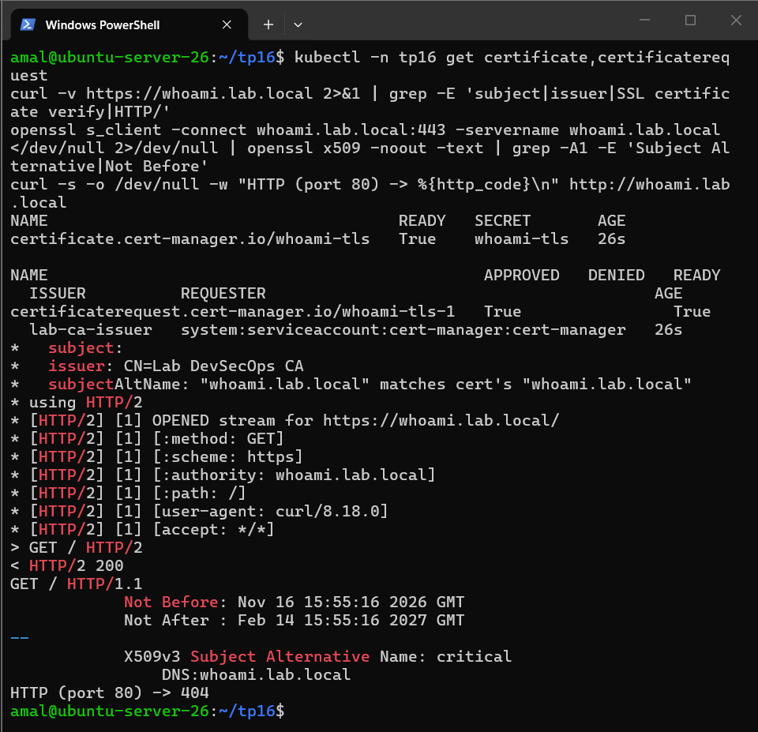
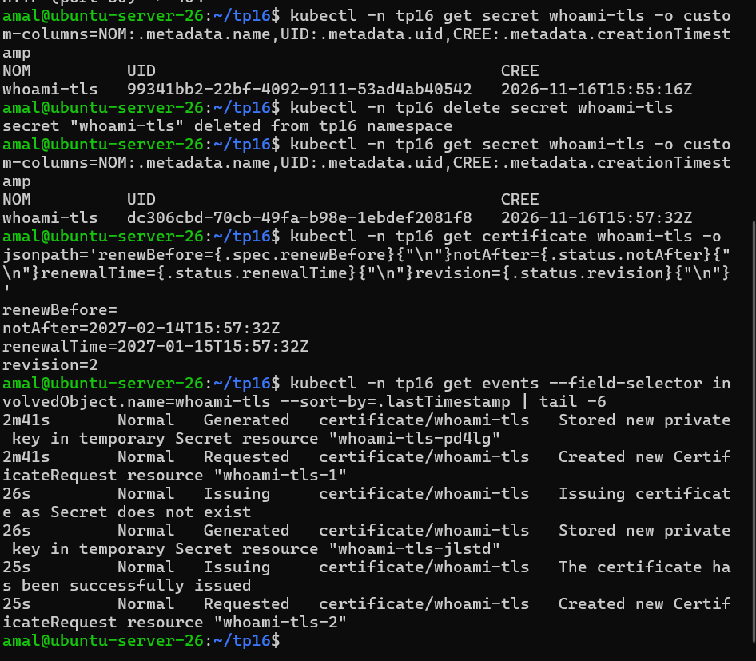
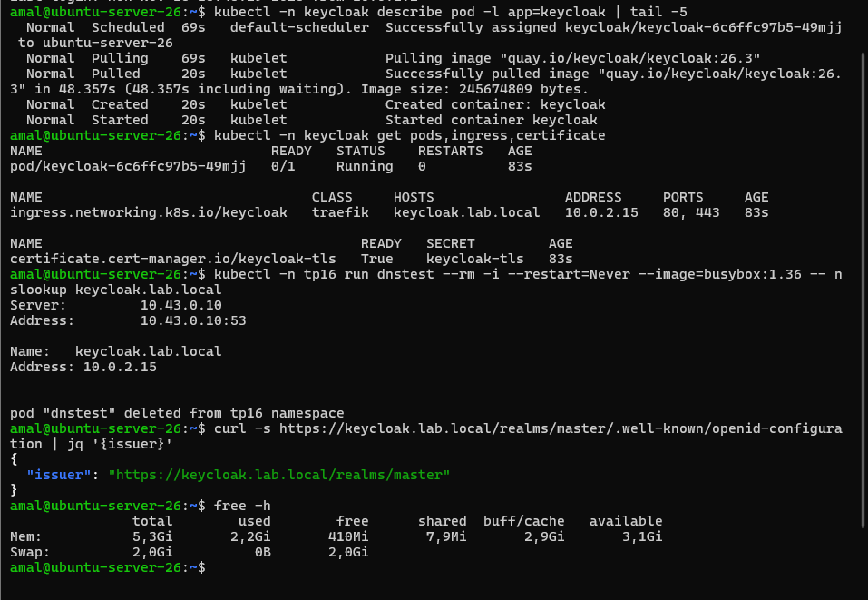
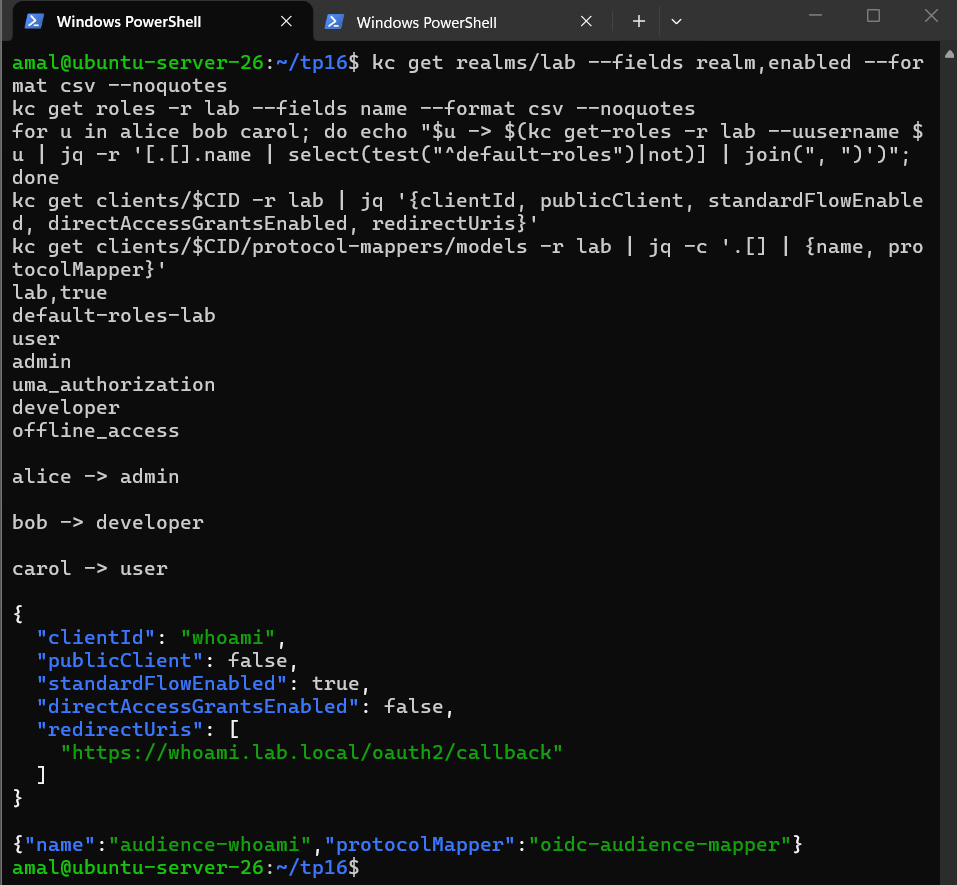
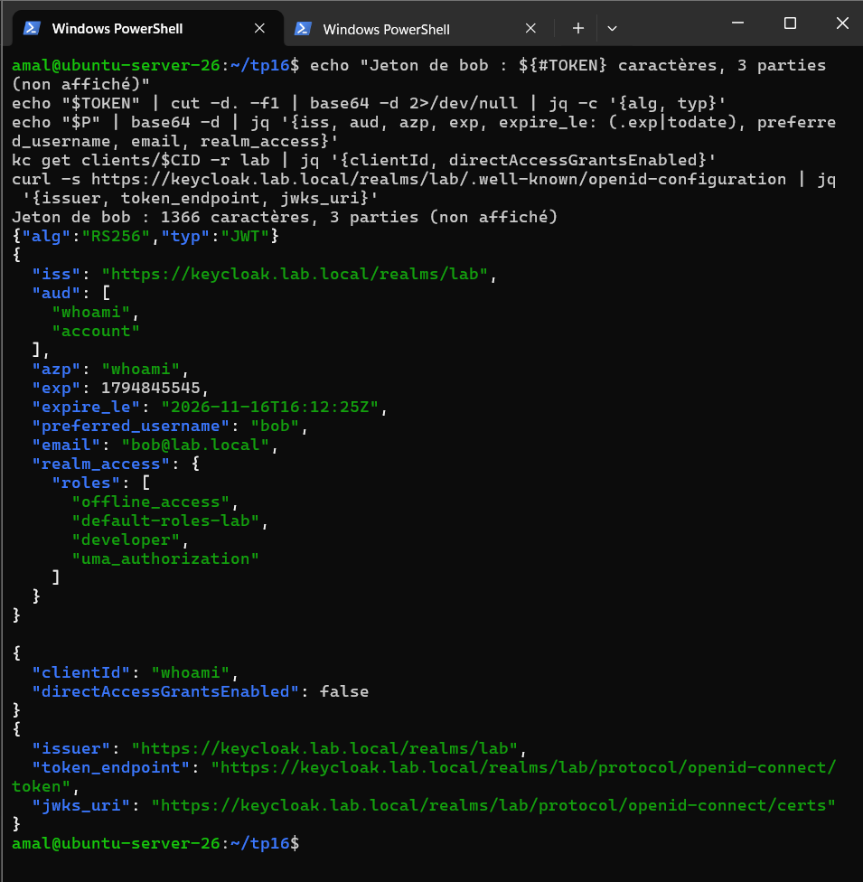
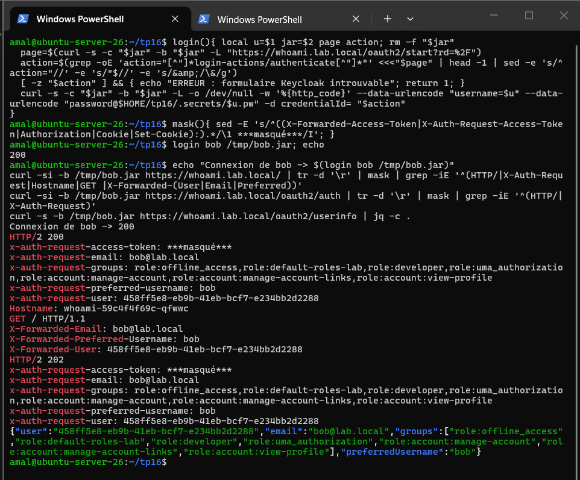
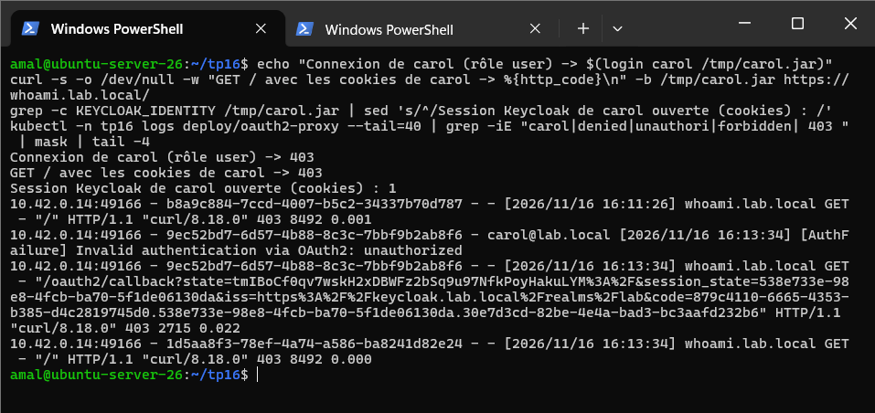
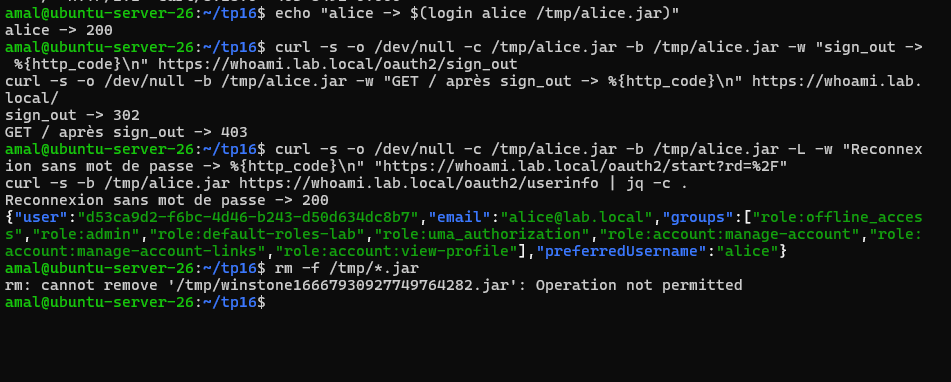

# TP16 : HTTPS avec cert-manager et IAM avec Keycloak (OIDC)

> **Cours** : DevOps & Cloud, M. Wahid ([énoncé](https://docs.teknolabs.net/courses/devops-cloud/partie-6-securite-plateforme/tp16-https-keycloak/))
> **Étudiante** : Amal Jemli, Master DevOps
> **Objectif** : chiffrer les échanges avec une CA de lab gérée par cert-manager, puis protéger une application sans modifier son code (Keycloak + oauth2-proxy) avec une autorisation par rôle.

## Sommaire
1. [Environnement](#1-environnement)
2. [Partie 1 : cert-manager et CA de lab](#2-partie-1--cert-manager-et-ca-de-lab)
3. [Partie 2 : Ingress HTTPS](#3-partie-2--ingress-https)
4. [Partie 3 : Keycloak](#4-partie-3--keycloak)
5. [Partie 4 : realm, rôles, utilisateurs, client](#5-partie-4--realm-rôles-utilisateurs-client)
6. [Partie 5 : oauth2-proxy](#6-partie-5--oauth2-proxy)
7. [Difficultés rencontrées](#7-difficultés-rencontrées)
8. [Sécurité](#8-sécurité)
9. [Livrables](#9-livrables)

---

## 1. Environnement

| Élément | Valeur |
|---|---|
| Cluster | K3s v1.34.12+k3s1, **mono-nœud** sur la VM de lab (plan B du TP14, 5,3 Go de RAM) |
| Ingress | Traefik (intégré à K3s), entrypoint `websecure` (443) |
| cert-manager | v1.19.1 (Helm, CRD incluses) |
| Keycloak | 26.3, mode `start-dev` (H2 en mémoire, lab uniquement) |
| oauth2-proxy | v7.9.0, fournisseur `keycloak-oidc`, PKCE S256 |
| Noms | `whoami.lab.local`, `keycloak.lab.local` → IP du nœud (`/etc/hosts` de la VM **et** CoreDNS du cluster) |

**Choix pour les tests** : la VM n'est joignable depuis Windows qu'en SSH (port 2222). Plutôt que de modifier le fichier `hosts` de Windows (droits administrateur), le **parcours navigateur est simulé avec `curl`** et un fichier de cookies : `/oauth2/start` → page de connexion Keycloak → envoi du formulaire → `/oauth2/callback` → application. Le **realm est configuré avec `kcadm.sh`** (CLI officielle de Keycloak) exécutée dans le pod : la configuration est reproductible et aucun mot de passe n'apparaît à l'écran.

Déroulé : les commandes ont été lancées **pas à pas** (détaillées dans chaque partie ci-dessous). Les mêmes étapes sont aussi fournies sous forme de scripts dans `scripts/` pour rejouer le TP :

| Script | Rôle | Capture |
|---|---|---|
| `0-setup.sh` | K3s, `/etc/hosts`, pré-téléchargement des images, `00-app.yaml` | — |
| `1-cert-manager.sh` | cert-manager, CA de lab, ClusterIssuers, confiance système | 📸 `clusterissuers.png` |
| `2-https.sh` | Ingress TLS, certificat émis, `curl -v`, SAN | 📸 `https-curl.png` |
| `2b-renew.sh` | suppression du Secret `whoami-tls`, `renewBefore` | texte |
| `3-keycloak.sh` | CoreDNS, Keycloak, Ingress HTTPS | texte |
| `4-realm.sh` | realm `lab`, rôles, utilisateurs, client `whoami`, mapper Audience | 📸 `keycloak-realm.png` |
| `4b-jwt.sh` | jeton de bob décodé, découverte OIDC | 📸 `jwt-decoded.png` |
| `5-oauth2-proxy.sh` | oauth2-proxy, Ingress basculé | texte |
| `5b-bob.sh` | bob autorisé, en-têtes `X-Auth-Request-*` | 📸 `oauth2-allowed.png` |
| `5c-carol.sh` | carol refusée (403) | 📸 `oauth2-403.png` |
| `5d-signout.sh` | alice, `/oauth2/sign_out`, persistance SSO | texte |
| `9-cleanup.sh` | nettoyage (K3s conservé pour le TP17) | — |

## 2. Partie 1 : cert-manager et CA de lab

Chaîne mise en place : `ClusterIssuer selfsigned` → `Certificate lab-ca` (`isCA: true`, ECDSA P-256, 1 an) → Secret `lab-ca` → `ClusterIssuer lab-ca-issuer` (type `ca`).

```yaml
# manifests/10-issuers.yaml (TODO complété)
spec:
  ca:
    secretName: lab-ca
```

```bash
helm install cert-manager jetstack/cert-manager -n cert-manager --create-namespace --version v1.19.1 --set crds.enabled=true --wait --timeout 15m
kubectl apply -f manifests/10-issuers.yaml
kubectl -n cert-manager get secret lab-ca -o jsonpath='{.data.ca\.crt}' | base64 -d > lab-ca.crt
sudo cp lab-ca.crt /usr/local/share/ca-certificates/lab-ca.crt && sudo update-ca-certificates   # 1 added
```



**Analyse**
- Les 3 composants de cert-manager tournent : le **contrôleur** (crée et renouvelle les certificats), le **cainjector** (injecte les CA dans les webhooks) et le **webhook** (valide les ressources `Certificate`/`Issuer`).
- `selfsigned` et `lab-ca-issuer` sont `READY True` : l'émetteur de type `ca` a bien trouvé le Secret `lab-ca`.
- Le Certificate `lab-ca` est `READY True`, stocké dans le Secret `lab-ca`.
- `subject` = `issuer` = `CN=Lab DevSecOps CA` : c'est un certificat **autosigné**, donc une racine. Il est valable **1 an** (`duration: 8760h`).
- `update-ca-certificates` : `1 added`. La VM fait désormais confiance à tout certificat signé par cette CA. Seul `ca.crt` (public) a été exporté ; `tls.key` reste dans le cluster.
- Note : depuis cert-manager 1.18, `rotationPolicy` vaut `Always` par défaut (nouvelle clé privée à chaque renouvellement). Elle est indiquée explicitement dans `10-issuers.yaml`.

## 3. Partie 2 : Ingress HTTPS

```yaml
# manifests/20-ingress-tls.yaml (TODO complétés)
annotations:
  cert-manager.io/cluster-issuer: lab-ca-issuer
  traefik.ingress.kubernetes.io/router.entrypoints: websecure
spec:
  tls:
    - hosts: [whoami.lab.local]
      secretName: whoami-tls
```

```bash
kubectl apply -f manifests/20-ingress-tls.yaml
kubectl -n tp16 wait --for=condition=Ready certificate/whoami-tls --timeout=120s
```



**Analyse**
- **ingress-shim** : grâce à l'annotation, cert-manager a créé seul le `Certificate whoami-tls`, puis la `CertificateRequest whoami-tls-1`, approuvée et signée par `lab-ca-issuer` (demandeur : le compte de service `cert-manager`). Aucun certificat n'a été écrit à la main.
- `issuer: CN=Lab DevSecOps CA` : le certificat de whoami est signé par notre CA.
- `subjectAltName: "whoami.lab.local" matches cert's "whoami.lab.local"`, puis `HTTP/2 200` : curl a **vérifié** la chaîne avec le magasin système (sans `-k`). Si la vérification avait échoué, curl se serait arrêté avec une erreur et il n'y aurait pas eu de réponse 200. curl 8.18 n'affiche plus la ligne `SSL certificate verify ok`.
- `subject` est vide : les navigateurs ne regardent plus le CN, seul le **SAN** compte (`DNS:whoami.lab.local`, marqué `critical`).
- Validité : du 16/11/2026 au 14/02/2027, soit **90 jours**, la durée par défaut de cert-manager (comme Let's Encrypt).
- `HTTP (port 80) -> 404` : la route n'existe que sur l'entrypoint `websecure`, donc rien n'est servi en clair. Pour une vraie redirection 80 → 443, il faudrait un Middleware Traefik `redirectScheme`.

### Question : suppression du Secret `whoami-tls` et `renewBefore`

 *(capture complémentaire)*

| | Avant | Après suppression |
|---|---|---|
| UID du Secret | `99341bb2-…` | `dc306cbd-…` (nouvel objet) |
| Création | 15:55:16 | 15:57:32 |
| CertificateRequest | `whoami-tls-1` | `whoami-tls-2` |
| `revision` du Certificate | 1 | **2** |

- **Que fait cert-manager ?** Il **recrée immédiatement** le Secret (événement *Issuing certificate as Secret does not exist*). C'est la **boucle de réconciliation** : le `Certificate` décrit l'état voulu, le contrôleur corrige tout écart avec l'état réel. Une **nouvelle clé privée** est générée (*Stored new private key in temporary Secret*), conformément à `rotationPolicy: Always`, puis une nouvelle CertificateRequest est signée par la CA.
- **Renouvellement anticipé** : c'est le champ **`spec.renewBefore`** du Certificate (on peut aussi utiliser `renewBeforePercentage`). Ici il est vide, donc cert-manager applique sa valeur par défaut : renouveler aux **2/3 de la durée de vie**. Pour un certificat de 90 jours, c'est 30 jours avant l'expiration : `renewalTime = 2027-01-15`, pour `notAfter = 2027-02-14`. Avec l'ingress-shim, on peut le régler par l'annotation `cert-manager.io/renew-before` sur l'Ingress.

## 4. Partie 3 : Keycloak

```bash
kubectl create namespace keycloak
kubectl -n keycloak create secret generic keycloak-admin --from-literal=password="$(openssl rand -base64 18)"  # jamais affiché
kubectl apply -f manifests/05-coredns-custom.yaml
kubectl -n kube-system rollout restart deploy/coredns
kubectl apply -f manifests/30-keycloak.yaml
kubectl -n keycloak rollout status deploy/keycloak --timeout=30m
```

 *(capture complémentaire)*

**Analyse**
- Image `quay.io/keycloak/keycloak:26.3` (245 Mo) téléchargée en 48 s, conteneur démarré.
- L'Ingress `keycloak` est publié sur `10.0.2.15` (ports 80 et 443). Le certificat `keycloak-tls` a été émis automatiquement par `lab-ca-issuer` (`READY True`).
- **DNS interne** : depuis un pod, `nslookup keycloak.lab.local` répond `10.0.2.15`, grâce au ConfigMap `coredns-custom` (clé `lab.server` chargée par K3s). C'est indispensable, car oauth2-proxy doit joindre Keycloak **par le même nom** que le navigateur, sinon l'`iss` des jetons ne correspond pas.
- La découverte OIDC répond en HTTPS vérifié, avec `issuer = https://keycloak.lab.local/realms/master` : `KC_HOSTNAME` et `KC_PROXY_HEADERS=xforwarded` sont bien pris en compte derrière Traefik, qui termine le TLS.
- RAM après déploiement : 3,1 Gi encore disponibles.
- Mode `start-dev` (H2 en mémoire) : réservé au lab. En production, il faut l'opérateur Keycloak, PostgreSQL, plusieurs instances et le mode `start`.

## 5. Partie 4 : realm, rôles, utilisateurs, client

| Utilisateur | Rôle de realm | Accès attendu à whoami |
|---|---|---|
| alice | admin | ✅ |
| bob | developer | ✅ |
| carol | user | ❌ 403 |

Client `whoami` : confidentiel, *Standard flow* uniquement, redirect URI `https://whoami.lab.local/oauth2/callback`, PKCE S256, mapper **Audience** (`aud` contient `whoami`).

Configuration scriptée avec **`kcadm.sh`** (CLI d'administration officielle), exécutée **dans le pod** :

```bash
# raccourci + connexion admin (mot de passe lu dans la variable d'environnement du pod, jamais affiché)
kc(){ c=$1; shift; kubectl -n keycloak exec deploy/keycloak -- /opt/keycloak/bin/kcadm.sh "$c" --config /tmp/kcadm.config "$@"; }
kubectl -n keycloak exec deploy/keycloak -- bash -c '/opt/keycloak/bin/kcadm.sh config credentials --config /tmp/kcadm.config --server http://localhost:8080 --realm master --user admin --password "$KC_BOOTSTRAP_ADMIN_PASSWORD"'
kc create realms -s realm=lab -s enabled=true
for r in user developer admin; do kc create roles -r lab -s name=$r; done
for u in alice bob carol; do kc create users -r lab -s username=$u -s enabled=true -s email=$u@lab.local -s emailVerified=true -s firstName=${u^} -s lastName=Lab; done
# mots de passe non temporaires, passés par l'entrée standard depuis ~/tp16/.secrets (600)
for u in alice bob carol; do kubectl -n keycloak exec -i deploy/keycloak -- bash -c 'read -r P || true; /opt/keycloak/bin/kcadm.sh set-password --config /tmp/kcadm.config -r lab --username "$1" --new-password "$P"' _ $u < ~/tp16/.secrets/$u.pw; done
kc add-roles -r lab --uusername alice --rolename admin    # idem bob/developer, carol/user
# client confidentiel (secret lu depuis le fichier), Standard flow seul, PKCE S256
kubectl -n keycloak exec -i deploy/keycloak -- bash -c 'read -r P || true; /opt/keycloak/bin/kcadm.sh create clients ... -s clientId=whoami -s publicClient=false -s "secret=$P" -s standardFlowEnabled=true -s directAccessGrantsEnabled=false -s "redirectUris=[\"https://whoami.lab.local/oauth2/callback\"]"' < ~/tp16/.secrets/client.secret
# mapper Audience (= onglet Client scopes -> whoami-dedicated)
kc create clients/$CID/protocol-mappers/models -r lab -s name=audience-whoami -s protocolMapper=oidc-audience-mapper -s 'config."included.client.audience"=whoami' -s 'config."access.token.claim"=true'
```



**Analyse**
- Realm `lab` actif. Il est **isolé** du realm `master` (réservé à l'administration de Keycloak).
- Rôles de realm : `user`, `developer`, `admin`, plus les 3 rôles créés par Keycloak (`default-roles-lab`, `offline_access`, `uma_authorization`).
- Attribution : **alice → admin, bob → developer, carol → user**. Le filtre `jq` masque le rôle composite `default-roles-lab`, attribué à tout le monde.
- Client `whoami` : **confidentiel** (`publicClient: false`, il s'authentifie avec un secret), **Standard flow uniquement** (Authorization Code, redirection vers la page de connexion de Keycloak), Direct access grants **désactivé**. La **redirect URI est exacte**, sans joker, ce qui empêche un attaquant de détourner le code d'autorisation vers son site.
- Mapper `oidc-audience-mapper` : ajoute `whoami` dans `aud`, que le destinataire du jeton (oauth2-proxy) vérifie.

### Jeton JWT de bob

Flux *password* (Direct access grants) **activé temporairement** pour observer un jeton, puis désactivé :

```bash
kc update clients/$CID -r lab -s directAccessGrantsEnabled=true
TOKEN=$(curl -s https://keycloak.lab.local/realms/lab/protocol/openid-connect/token -d grant_type=password -d client_id=whoami \
  --data-urlencode "client_secret@$HOME/tp16/.secrets/client.secret" -d username=bob --data-urlencode "password@$HOME/tp16/.secrets/bob.pw" | jq -r .access_token)
kc update clients/$CID -r lab -s directAccessGrantsEnabled=false
P=$(echo "$TOKEN" | cut -d. -f2 | tr '_-' '/+'); while [ $(( ${#P} % 4 )) -ne 0 ]; do P="$P="; done   # base64url -> base64 + remplissage
echo "$P" | base64 -d | jq '{iss, aud, azp, exp, expire_le: (.exp|todate), preferred_username, email, realm_access}'
unset TOKEN P
```



| Claim | Valeur | Signification |
|---|---|---|
| `alg` (en-tête) | `RS256` | signature RSA avec la clé privée du realm ; vérifiable avec la clé publique publiée sur `jwks_uri` |
| `iss` | `https://keycloak.lab.local/realms/lab` | émetteur, identique à l'`issuer` de la découverte OIDC |
| `aud` | `["whoami", "account"]` | `whoami` est ajouté par le mapper Audience ; `account` vient du client par défaut de Keycloak |
| `azp` | `whoami` | client qui a obtenu le jeton (*authorized party*) |
| `exp` | `2026-11-16T16:12:25Z` | durée de vie courte (5 min par défaut) |
| `preferred_username` / `email` | `bob` / `bob@lab.local` | identité (OpenID Connect) |
| `realm_access.roles` | `developer`, `default-roles-lab`, `offline_access`, `uma_authorization` | rôles de realm, utilisés par `--allowed-role` |

- Le JWT est **encodé (base64url), pas chiffré** : n'importe qui peut le lire. Il ne doit contenir aucune donnée secrète, et sa sécurité repose sur la **signature** et sur la courte durée de `exp`.
- **Authentification ≠ autorisation** : le jeton prouve *qui* est bob (OIDC) ; la décision « bob a-t-il le droit ? » est prise par l'application (ici oauth2-proxy) à partir de `realm_access.roles` et de `aud`.
- Après l'observation, `directAccessGrantsEnabled` est revenu à `false`. Le flux *password* expose le mot de passe à l'application, et il est déprécié dans OAuth 2.1.
- Découverte OIDC (`/.well-known/openid-configuration`) : `issuer`, `token_endpoint` et `jwks_uri` permettent à un client de se configurer automatiquement. C'est ce qu'oauth2-proxy fait avec `--oidc-issuer-url`.

## 6. Partie 5 : oauth2-proxy

```yaml
# manifests/40-oauth2-proxy.yaml (TODO complété)
- --allowed-role=developer
- --allowed-role=admin
```
L'Ingress `whoami` pointe ensuite vers le Service `oauth2-proxy` (`manifests/41-ingress-oauth2-proxy.yaml`).

```bash
kubectl -n tp16 create secret generic oauth2-proxy --from-file=client-secret=$HOME/tp16/.secrets/client.secret \
  --from-literal=cookie-secret="$(openssl rand -base64 32 | tr -- '+/' '-_' | head -c 32)"
kubectl -n tp16 create secret generic lab-ca-public --from-file=ca.crt=lab-ca.crt     # certificat PUBLIC de la CA
kubectl apply -f manifests/40-oauth2-proxy.yaml
kubectl apply -f manifests/41-ingress-oauth2-proxy.yaml
```

Résultat (texte) :
```text
pod/oauth2-proxy-7474964576-spks9   1/1  Running
backend de l'Ingress whoami       : oauth2-proxy
Sans session : GET / -> 403
[oauthproxy.go:176] OAuthProxy configured for Keycloak OIDC Client ID: whoami
[oauthproxy.go:182] Cookie settings: name:_oauth2_proxy secure(https):true httponly:true expiry:168h0m0s
[oauthproxy.go:1030] No valid authentication in request. Initiating login.
```
- oauth2-proxy a lu la **découverte OIDC** de `https://keycloak.lab.local/realms/lab` au démarrage, sans erreur TLS : la CA de lab est montée via `--provider-ca-file`, et CoreDNS résout le nom.
- whoami n'est **plus joignable sans authentification** : `403`, avec la page *Sign in* d'oauth2-proxy.
- Le cookie de session est `Secure` (HTTPS seulement) et `HttpOnly` (illisible par JavaScript, ce qui limite le vol par XSS). Il est chiffré avec `cookie-secret`.

### Tests : connexion simulée avec `curl`

La VM n'a pas de navigateur. Le parcours est donc **rejoué avec `curl` et un fichier de cookies**, exactement comme le ferait un navigateur : `/oauth2/start` → page de connexion Keycloak → envoi du formulaire (mot de passe lu dans `~/tp16/.secrets`) → `/oauth2/callback` (échange du code + PKCE) → cookie `_oauth2_proxy` → application.

```bash
login(){ local u=$1 jar=$2 page action; rm -f "$jar"
  page=$(curl -s -c "$jar" -b "$jar" -L "https://whoami.lab.local/oauth2/start?rd=%2F")
  action=$(grep -oE 'action="[^"]*login-actions/authenticate[^"]*"' <<<"$page" | head -1 | sed -e 's/^action="//' -e 's/"$//' -e 's/&amp;/\&/g')
  [ -z "$action" ] && { echo "ERREUR : formulaire Keycloak introuvable"; return 1; }
  curl -s -c "$jar" -b "$jar" -L -o /dev/null -w '%{http_code}' --data-urlencode "username=$u" --data-urlencode "password@$HOME/tp16/.secrets/$u.pw" -d credentialId= "$action"
}
mask(){ sed -E 's/^((X-Forwarded-Access-Token|X-Auth-Request-Access-Token|Authorization|Cookie|Set-Cookie):).*/\1 ***masqué***/I'; }
```

#### bob (developer) : accès autorisé



- Connexion `200`, puis `GET /` → **`HTTP/2 200`** servi par le pod `whoami-59c4f4f69c-qfwwc`.
- **En-têtes reçus par whoami** (requête transmise par oauth2-proxy) : `X-Forwarded-User` (identifiant `sub` de bob dans Keycloak), `X-Forwarded-Email: bob@lab.local`, `X-Forwarded-Preferred-Username: bob`. L'application connaît l'utilisateur **sans aucune ligne de code d'authentification**.
- **En-têtes `X-Auth-Request-*`** (`--set-xauthrequest`) : `user`, `email`, `preferred-username`, `groups`. Ils sont renvoyés aussi par `/oauth2/auth` (**202**), l'endpoint qu'utiliserait un Ingress NGINX en mode `auth_request`.
- `groups` contient `role:developer` : c'est sur cette valeur que `--allowed-role=developer` a autorisé bob.
- `x-auth-request-access-token` est **masqué** dans la capture. Avec `--pass-access-token`, le jeton est transmis à l'application : il ne doit jamais être journalisé.

#### carol (user) : accès refusé



- Keycloak a **authentifié** carol : bon mot de passe, et une session Keycloak est ouverte (cookie `KEYCLOAK_IDENTITY` présent).
- Mais au **callback**, oauth2-proxy vérifie ses rôles : `realm_access.roles` ne contient ni `developer` ni `admin`. Résultat : **`403`** et le log `[AuthFailure] Invalid authentication via OAuth2: unauthorized` pour `carol@lab.local`.
- Aucun cookie `_oauth2_proxy` ne lui est donné, donc `GET /` reste à `403`.
- **Authentification ≠ autorisation** : savoir *qui* est l'utilisateur (Keycloak, OIDC) n'implique pas qu'il ait le *droit* d'accéder (oauth2-proxy, `--allowed-role`).
- Remarque : le log du callback contient le **code d'autorisation**. Il est à usage unique et déjà consommé (et protégé par PKCE), mais en production il faut limiter le niveau de journalisation des URL de callback.

#### Déconnexion et persistance de la session (SSO)

 *(capture complémentaire)*

| Action | Résultat |
|---|---|
| Connexion d'alice (admin) | `200` |
| `GET /oauth2/sign_out` | `302` : le cookie `_oauth2_proxy` est supprimé |
| `GET /` après la déconnexion | `403` : plus de session oauth2-proxy |
| `GET /oauth2/start` **sans envoyer de mot de passe** | **`200`** : alice est reconnectée automatiquement |

**Pourquoi la session survit :** `/oauth2/sign_out` ne détruit que la session **locale** d'oauth2-proxy. La session **Keycloak** (cookies `KEYCLOAK_IDENTITY`/`KEYCLOAK_SESSION` sur `keycloak.lab.local`) reste valide. Au retour sur `/oauth2/start`, Keycloak reconnaît la session et renvoie immédiatement un nouveau code, sans afficher le formulaire. C'est le **Single Sign-On** : on se connecte une fois chez le fournisseur d'identité pour toutes les applications.

Pour une déconnexion complète, il faut aussi fermer la session chez Keycloak (*RP-initiated logout*) : rediriger après `sign_out` vers l'`end_session_endpoint` du realm (`/realms/lab/protocol/openid-connect/logout`, avec `id_token_hint` et `post_logout_redirect_uri`). Avec oauth2-proxy : `/oauth2/sign_out?rd=<URL de logout Keycloak encodée>`, ou l'option `--backend-logout-url`. On peut aussi fermer la session dans la console Keycloak (*Users → Sessions → Sign out*).

## 7. Difficultés rencontrées

| Problème | Cause | Solution |
|---|---|---|
| `Warning: … missing the kubectl.kubernetes.io/last-applied-configuration annotation` | Namespace `keycloak` créé avec `kubectl create`, puis ré-appliqué par `kubectl apply -f 30-keycloak.yaml` | Sans gravité : kubectl ajoute l'annotation automatiquement. Bonne pratique : ne gérer un objet qu'avec `apply` |
| `Client whoami already exists` (exit code 1) | Commande de création du client lancée deux fois | Sans conséquence : Keycloak refuse un doublon de `clientId`, le premier client est conservé |
| `rm: cannot remove '/tmp/winstone…jar': Operation not permitted` | `rm -f /tmp/*.jar` a aussi visé un fichier de Jenkins (TP précédents) appartenant à un autre utilisateur | Sans conséquence : nos fichiers de cookies sont bien supprimés. À l'avenir, nommer précisément `/tmp/{alice,bob,carol}.jar` |
| Avertissement `rotationPolicy` de cert-manager | Le défaut est passé de `Never` à `Always` en v1.18 | `rotationPolicy: Always` rendu explicite dans `10-issuers.yaml` |
| Après réinstallation de K3s, pods système en `ImagePullBackOff` et whoami en `ContainerCreating` pendant 9 min | Toutes les images retéléchargées en même temps sur une connexion lente | Attendre : kubelet réessaie avec un délai croissant ; tout est passé en `Running` |

## 8. Sécurité

- **Clé privée de la CA** (`tls.key` du Secret `lab-ca`) : jamais exportée ; seul `ca.crt` (public) est extrait et mis en confiance.
- **Mot de passe admin Keycloak** : généré dans le Secret `keycloak-admin`, utilisé par `kcadm.sh` via la variable d'environnement du pod, jamais affiché.
- **Mots de passe des utilisateurs et secret du client** : générés dans `~/tp16/.secrets` (700/600) sur la VM, transmis par l'entrée standard ou `curl --data-urlencode @fichier` (absents de l'historique et de `ps`).
- **Jetons et cookies** masqués dans les sorties (`***masqué***`).
- Flux *password* (Direct access grants) activé **uniquement** le temps d'observer un jeton, puis désactivé.
- HTTP en clair désactivé (route uniquement sur `websecure`).
- Keycloak en `start-dev` (H2 en mémoire) : **lab uniquement**, un redémarrage du pod efface le realm.

## 9. Livrables

| Capture | Contenu | État |
|---|---|---|
| `captures/clusterissuers.png` | ClusterIssuers et Certificate de la CA | ✅ |
| `captures/https-curl.png` | `curl -v` : certificat vérifié, émis par la CA de lab | ✅ |
| `captures/keycloak-realm.png` | Realm `lab`, rôles et utilisateurs | ✅ |
| `captures/jwt-decoded.png` | Jeton décodé : `iss`, `aud`, `exp`, rôles | ✅ |
| `captures/oauth2-allowed.png` | Accès autorisé (bob) avec `X-Auth-Request-*` | ✅ |
| `captures/oauth2-403.png` | Accès refusé (carol) | ✅ |
| `captures/renew-secret.png` | *(bonus)* Secret supprimé puis recréé, `renewalTime` | ✅ |
| `captures/keycloak-deploy.png` | *(bonus)* Keycloak déployé, DNS interne, découverte OIDC | ✅ |
| `captures/sso-signout.png` | *(bonus)* `sign_out` puis reconnexion SSO sans mot de passe | ✅ |

Fichiers : `manifests/` (00, 05, 10, 20, 30, 40 complétés + 41), `scripts/`.
