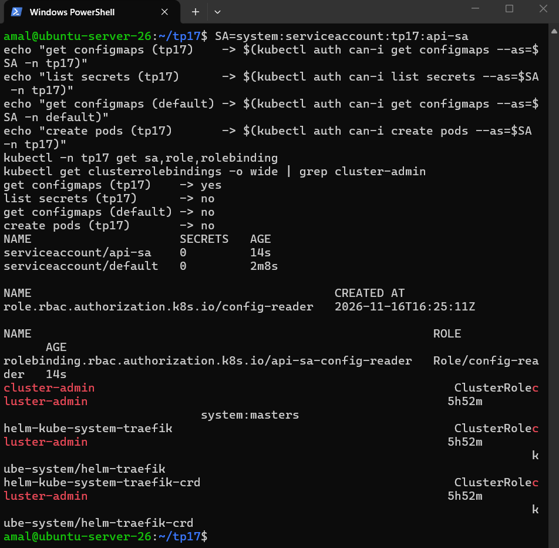
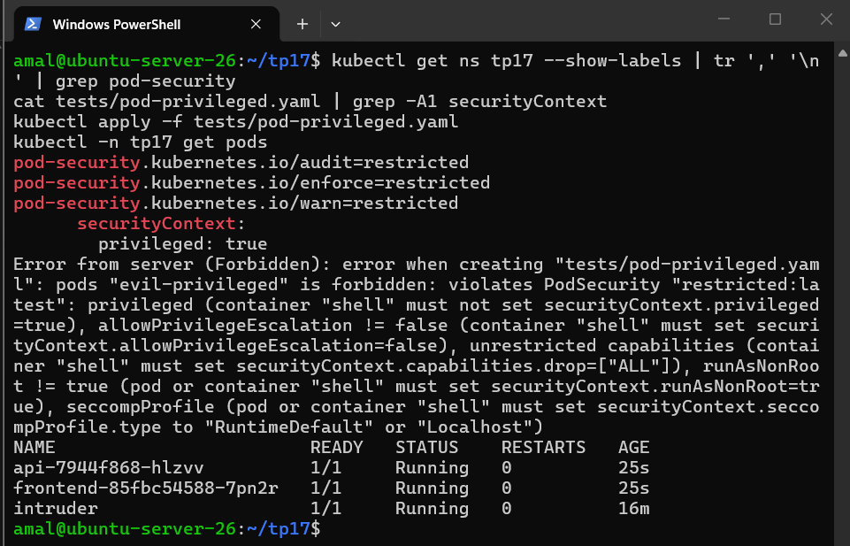

# TP17 : Sécurité Kubernetes (RBAC, Pod Security, NetworkPolicy, Kyverno, Falco)

> **Cours** : DevOps & Cloud, M. Wahid ([énoncé](https://docs.teknolabs.net/courses/devops-cloud/partie-6-securite-plateforme/tp17-kubernetes-security/))
> **Étudiante** : Amal Jemli, Master DevOps
> **Objectif** : appliquer la défense en profondeur à une application volontairement mal configurée : moindre privilège (RBAC), durcissement des Pods (securityContext, PSS), segmentation réseau (NetworkPolicy), Policy as Code (Kyverno), analyse continue (Trivy Operator, Kubescape) et détection à l'exécution (Falco).

## Sommaire
1. [Environnement](#1-environnement)
2. [Partie 1 : RBAC et ServiceAccount](#2-partie-1--rbac-et-serviceaccount)
3. [Partie 2 : securityContext](#3-partie-2--securitycontext)
4. [Partie 3 : Pod Security Standards](#4-partie-3--pod-security-standards)
5. [Partie 4 : NetworkPolicies](#5-partie-4--networkpolicies)
6. [Partie 5 : Kyverno](#6-partie-5--kyverno)
7. [Partie 6 : Trivy Operator, Kubescape, Falco](#7-partie-6--trivy-operator-kubescape-falco)
8. [Difficultés rencontrées](#8-difficultés-rencontrées)
9. [Sécurité](#9-sécurité)
10. [Livrables](#10-livrables)

---

## 1. Environnement

| Élément | Valeur |
|---|---|
| Cluster | K3s v1.34.12+k3s1, mono-nœud sur la VM de lab |
| RAM | **5,3 Go** alors que le TP demande ≥ 8 Go : **plan B**, voir ci-dessous |
| Outils | Helm (Kyverno, Trivy Operator, Falco), Docker (Kyverno CLI), Kubescape |

**Plan B mémoire** : les composants du TP16 (Keycloak, oauth2-proxy, cert-manager) sont supprimés avant de commencer, et les outils lourds sont installés **l'un après l'autre**. Kyverno est désinstallé après ses captures, avant Trivy Operator, puis Trivy Operator avant Falco.

Fichiers :

| Fichier | Rôle |
|---|---|
| `manifests/00-app.yaml` | application d'origine, **volontairement non sécurisée** (conservée pour les comparaisons « avant ») |
| `manifests/01-app-hardened.yaml` | Deployments `api` et `frontend` **durcis** (partie 2) |
| `manifests/10-rbac.yaml` | ServiceAccount `api-sa`, Role `config-reader`, RoleBinding (TODO complétés) |
| `manifests/20-networkpolicies.yaml` | default deny + DNS + frontend → api (TODO complétés) |
| `policies/*.yaml` | ClusterPolicies Kyverno : `disallow-latest-tag` (fournie), `disallow-privileged`, `require-run-as-non-root`, `require-requests-limits` |
| `tests/pod-privileged.yaml` | Pod privilégié pour tester PSS |
| `tests/deploy-non-conforme.yaml` | Deployment non conforme pour tester Kyverno en Enforce |
| `tests/frontend-client.yaml` | plan B : client busybox `tier=frontend` conforme au profil restricted |

> ⏳ Les parties ci-dessous sont complétées au fur et à mesure des captures.

## 2. Partie 1 : RBAC et ServiceAccount

```yaml
# manifests/10-rbac.yaml (TODO complétés)
rules:
  - apiGroups: [""]
    resources: ["configmaps"]
    verbs: ["get", "list", "watch"]
---
subjects:
  - { kind: ServiceAccount, name: api-sa, namespace: tp17 }
roleRef: { apiGroup: rbac.authorization.k8s.io, kind: Role, name: config-reader }
```

```bash
kubectl apply -f manifests/10-rbac.yaml
SA=system:serviceaccount:tp17:api-sa
kubectl auth can-i get configmaps --as=$SA -n tp17      # yes
kubectl auth can-i list secrets   --as=$SA -n tp17      # no
kubectl auth can-i get configmaps --as=$SA -n default   # no
kubectl auth can-i create pods    --as=$SA -n tp17      # no
```



**Analyse**
- `api-sa` peut **lire les ConfigMaps de `tp17`**, et rien d'autre : ni Secrets, ni autre namespace, ni création de Pods. C'est le **moindre privilège**. Tout ce qui n'est pas explicitement autorisé est refusé (le RBAC n'a pas de règle « deny »).
- `kubectl auth can-i --as=` utilise l'**usurpation d'identité** (*impersonation*) de l'admin pour tester les droits d'un compte sans avoir son jeton.
- **`automountServiceAccountToken: false`** (sur le ServiceAccount et dans le Pod) : aucun jeton n'est monté dans `/var/run/secrets/kubernetes.io/serviceaccount`. Si le conteneur est compromis, l'attaquant n'a **aucun identifiant** pour interroger l'API Kubernetes. Il faut l'activer seulement pour les applications qui parlent réellement à l'API.
- `api-sa` est associé au Deployment `api` par `serviceAccountName: api-sa` dans `01-app-hardened.yaml` (partie 2). Sans cela, le Pod tourne avec le ServiceAccount `default`.

| | Portée | Exemple |
|---|---|---|
| **Role** | droits **dans un namespace** | `config-reader` : lire les ConfigMaps de `tp17` |
| **ClusterRole** | droits sur **tout le cluster**, ou sur des ressources non namespacées (nodes, PV, CRD) | `cluster-admin`, `view`, `edit` |
| **RoleBinding** | attribue un Role, **ou un ClusterRole**, dans **un seul namespace** | donner `view` seulement sur `tp17` |
| **ClusterRoleBinding** | attribue un ClusterRole **dans tous les namespaces** | à réserver aux administrateurs |

**ClusterRoleBindings vers `cluster-admin`** (droits illimités) :

| Binding | Sujet | Commentaire |
|---|---|---|
| `cluster-admin` | groupe `system:masters` | administrateurs (le kubeconfig de K3s). Ce groupe contourne même le RBAC, d'où l'importance de protéger `k3s.yaml` |
| `helm-kube-system-traefik` | SA `kube-system/helm-traefik` | job d'installation de Traefik par K3s |
| `helm-kube-system-traefik-crd` | SA `kube-system/helm-traefik-crd` | job d'installation des CRD de Traefik |

Ces deux jobs sont terminés (`Completed`), mais leurs bindings `cluster-admin` restent. C'est un point à **auditer régulièrement** : tout nouveau binding `cluster-admin` doit être justifié.

## 3. Partie 2 : securityContext

Extrait de `manifests/01-app-hardened.yaml` (Deployment `frontend`) :
```yaml
spec:
  automountServiceAccountToken: false
  securityContext:
    runAsNonRoot: true
    runAsUser: 101
    seccompProfile: { type: RuntimeDefault }
  containers:
    - name: frontend
      image: nginxinc/nginx-unprivileged:1.29   # port 8080, sans root
      securityContext:
        allowPrivilegeEscalation: false
        readOnlyRootFilesystem: true
        capabilities: { drop: ["ALL"] }
      resources:
        requests: { cpu: 20m, memory: 32Mi }
        limits:   { cpu: 200m, memory: 64Mi }
      volumeMounts: [{ name: tmp, mountPath: /tmp }]
  volumes: [{ name: tmp, emptyDir: { sizeLimit: 16Mi } }]
```

| Avant (`00-app.yaml`) | Après (`01-app-hardened.yaml`) |
|---|---|
| `api` : `traefik/whoami:latest`, **`privileged: true`**, sans limites | `whoami:v1.10.0`, UID 65532, `serviceAccountName: api-sa`, jeton non monté |
| `frontend` : `nginx:1.29` en **root**, port 80 | `nginx-unprivileged:1.29`, UID 101, port 8080 |
| aucun `securityContext` | non-root, pas d'élévation de privilèges, FS racine en lecture seule, `drop ALL`, seccomp `RuntimeDefault` |
| aucune requests/limits | requests CPU/mémoire et limites |

Résultat (texte) :
```text
$ kubectl -n tp17 exec deploy/frontend -- id
uid=101(nginx) gid=101(nginx) groups=101(nginx)
$ kubectl -n tp17 exec deploy/frontend -- touch /etc/test
touch: cannot touch '/etc/test': Read-only file system
$ kubectl -n tp17 exec deploy/frontend -- touch /tmp/test
/tmp : écriture OK (emptyDir)
$ kubectl -n tp17 get deploy api -o jsonpath='{.spec.template.spec.serviceAccountName}'
api-sa
```
- nginx tourne sous **UID 101**, et non 0 : une faille dans nginx ne donne pas les droits root dans le conteneur.
- **FS racine en lecture seule** : impossible de modifier les binaires ou la configuration, ou de déposer un outil d'attaque. Seul `/tmp` (volume `emptyDir`, limité à 16 Mi et détruit avec le Pod) est inscriptible, parce que nginx y écrit son PID et ses fichiers temporaires.
- Le rollout s'est fait **sans interruption** : les nouveaux Pods étaient prêts avant la suppression des anciens.

## 4. Partie 3 : Pod Security Standards

| Profil | Ce qu'il interdit |
|---|---|
| `privileged` | rien (aucune restriction) |
| `baseline` | `privileged`, `hostNetwork`/`hostPID`/`hostIPC`, `hostPath`, capacités dangereuses, ports d'hôte |
| `restricted` | baseline **+** exécution en root, élévation de privilèges, capacités non retirées (`drop ALL`), absence de seccomp |

```bash
# 1. observer sans bloquer
kubectl label ns tp17 pod-security.kubernetes.io/warn=restricted pod-security.kubernetes.io/audit=restricted --overwrite
kubectl -n tp17 rollout restart deploy          # aucun avertissement : api et frontend sont conformes
# 2. bloquer
kubectl label ns tp17 pod-security.kubernetes.io/enforce=restricted --overwrite
# Warning: existing pods in namespace "tp17" violate the new PodSecurity enforce level "restricted:latest"
# Warning: intruder: allowPrivilegeEscalation != false, unrestricted capabilities, runAsNonRoot != true, seccompProfile
# 3. tester
kubectl apply -f tests/pod-privileged.yaml
```



**Analyse**
- En mode `warn`/`audit`, le redémarrage des Deployments durcis n'a produit **aucun avertissement** : la partie 2 les a rendus conformes au profil `restricted`.
- Au passage en `enforce`, l'API server **signale** que le Pod `intruder` (busybox en root, sans securityContext) viole le profil, mais **ne le supprime pas** : PSS est un contrôle d'**admission**, appliqué seulement à la création ou à la modification d'un Pod. Les Pods existants doivent être corrigés ou recréés.
- Le Pod `evil-privileged` est **refusé par l'API server** (`Forbidden`) avant toute exécution. Le message liste les 5 violations : `privileged`, `allowPrivilegeEscalation`, capacités non retirées, `runAsNonRoot`, `seccompProfile`.
- `restricted:latest` : on peut figer la version du profil avec le label `pod-security.kubernetes.io/enforce-version=v1.34`, pour éviter qu'une mise à jour de Kubernetes ne durcisse les règles sans prévenir.
- Démarche recommandée : **warn/audit d'abord**, corriger, **puis enforce**. C'est la même logique qu'Audit puis Enforce avec Kyverno (partie 5).

## 5. Partie 4 : NetworkPolicies

| Policy | Pods visés | Effet |
|---|---|---|
| `default-deny-all` | tous | bloque **tout** l'Ingress et l'Egress, y compris le DNS |
| `allow-dns-egress` | tous | sortie autorisée vers `kube-system/k8s-app=kube-dns`, UDP/TCP 53 |
| `api-allow-frontend` | `app=api` | entrée autorisée **uniquement** depuis `tier=frontend`, port 8080 |
| `frontend-allow-egress-api` | `tier=frontend` | sortie autorisée uniquement vers `app=api`, port 8080 |

```yaml
# extrait (TODO complété) : l'API n'accepte que le frontend
spec:
  podSelector: { matchLabels: { app: api } }
  policyTypes: ["Ingress"]
  ingress:
    - from: [{ podSelector: { matchLabels: { tier: frontend } } }]
      ports: [{ protocol: TCP, port: 8080 }]   # port du conteneur, et non le port 80 du Service
```

```bash
kubectl apply -f manifests/20-networkpolicies.yaml
kubectl apply -f tests/frontend-client.yaml     # plan B : busybox tier=frontend (l'image nginx-unprivileged n'a pas wget)
kubectl -n tp17 exec frontend-client -- wget -qO- -T 3 http://api   # OK
kubectl -n tp17 exec intruder        -- wget -qO- -T 3 http://api   # bloqué
```


**Analyse**
- **frontend → api : autorisé**. whoami répond (`Hostname: api-7944f868-hlzvv`). Le client porte le label `tier=frontend`, comme le Deployment `frontend`.
- **intruder → api : bloqué** (`app=intruder` ne correspond à aucune règle d'entrée de l'API). Le TP annonce un *timeout*. Avec K3s, on obtient `Connection refused` : le contrôleur de NetworkPolicies intégré (**kube-router**) **rejette** activement les paquets interdits (`REJECT`, réponse immédiate) au lieu de les ignorer (`DROP`, attente jusqu'au timeout, comme avec Calico ou Cilium). Dans les deux cas, la connexion est impossible.
- **DNS** : l'intrus résout encore `api.tp17.svc.cluster.local` → `10.43.66.70`, grâce à `allow-dns-egress`. Sans cette règle, `default-deny-all` casse toute résolution de noms. C'est le piège classique du *default deny*.
- Les NetworkPolicies sont **additives** : on part de « tout interdit » et chaque policy ouvre un flux précis. Il n'y a pas de règle « deny » explicite.
- Les sélecteurs portent sur les **labels des Pods**, pas sur les IP (qui changent à chaque redémarrage). Un attaquant qui peut créer un Pod avec le label `tier=frontend` contournerait la règle : d'où l'intérêt du RBAC (partie 1) et de l'admission (PSS, Kyverno) pour contrôler qui crée quoi.

## 6. Partie 5 : Kyverno
> ⏳

## 7. Partie 6 : Trivy Operator, Kubescape, Falco
> ⏳

## 8. Difficultés rencontrées

| Problème | Cause | Solution |
|---|---|---|
| `wget: executable file not found` dans `frontend` | L'image `nginx-unprivileged` est minimale, sans `wget` ni `curl` | Plan B : Pod `frontend-client` (busybox, label `tier=frontend`, conforme au profil `restricted`) |
| `Connection refused` au lieu du *timeout* attendu | kube-router (NetworkPolicies de K3s) utilise `REJECT` et non `DROP` | Comportement attendu : le flux est bien bloqué |
| `nslookup … \| tail -2` n'affiche rien | La sortie de busybox `nslookup` se termine par des lignes vides | `grep -A1 "Name:"` |

## 9. Sécurité
> ⏳

## 10. Livrables

| Capture | Contenu | État |
|---|---|---|
| `captures/rbac-can-i.png` | Résultats `kubectl auth can-i` (yes / no) | ✅ |
| `captures/pss-denied.png` | Pod privilégié refusé par le profil `restricted` | ✅ |
| `captures/netpol.png` | Frontend → API OK, intrus → API bloqué | ✅ |
| `captures/kyverno-enforce.png` | Deployment non conforme refusé avec le message de la policy | ⏳ |
| `captures/kyverno-cli.png` | Résultat de `kyverno apply` en ligne de commande | ⏳ |
| `captures/trivy-kubescape.png` | Rapports Trivy Operator et score Kubescape avant / après | ⏳ |
| `captures/falco-alert.png` | Alerte Falco après la lecture de `/etc/shadow` | ⏳ |
