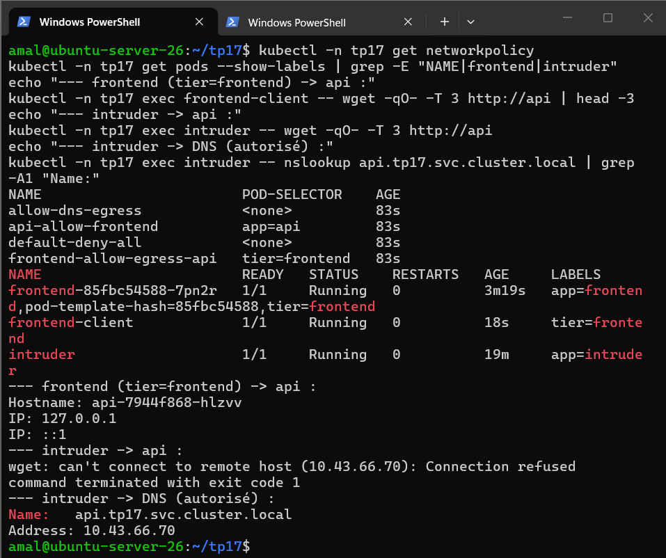
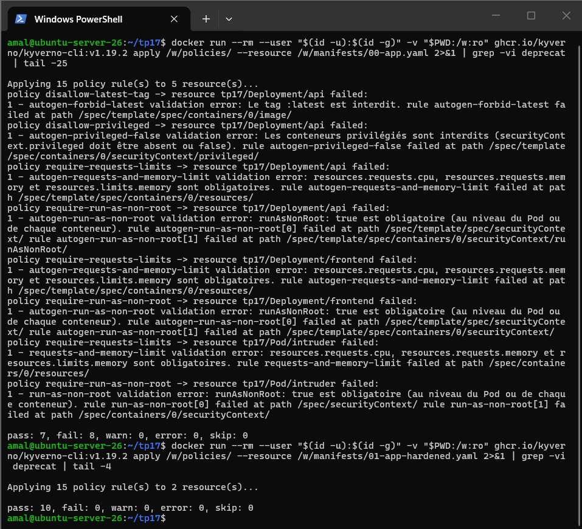
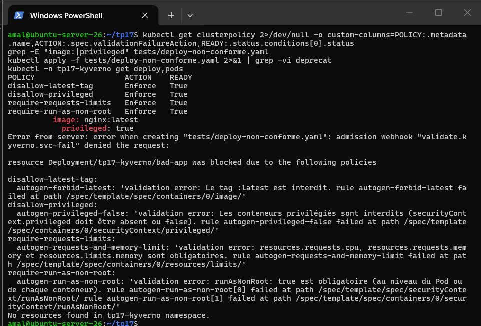
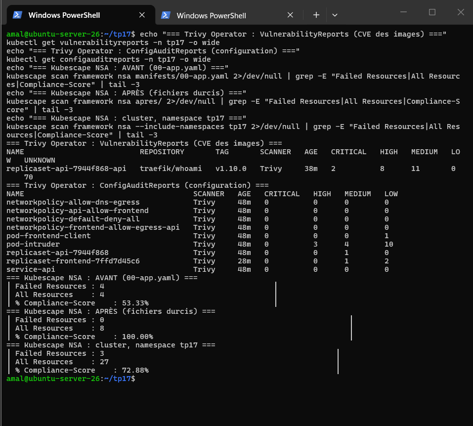
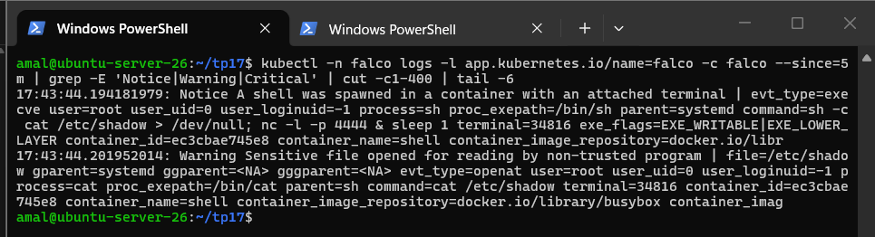

# TP17 : Sécurité Kubernetes (RBAC, Pod Security, NetworkPolicy, Kyverno, Falco)

> **Cours** : DevOps & Cloud, M. Wahid ([énoncé](https://docs.teknolabs.net/courses/devops-cloud/partie-6-securite-plateforme/tp17-kubernetes-security/))
> **Étudiante** : Amal Jemli, Master DevOps
> **Objectif** : appliquer la défense en profondeur à une application volontairement mal configurée : moindre privilège (RBAC), durcissement des Pods (securityContext, PSS), segmentation réseau (NetworkPolicy), Policy as Code (Kyverno), analyse continue (Trivy Operator, Kubescape) et détection à l'exécution (Falco).

## Sommaire
1. [Environnement](#1-environnement)
2. [Partie 1 : RBAC et ServiceAccount](#2-partie-1--rbac-et-serviceaccount)
3. [Partie 2 : securityContext](#3-partie-2--securitycontext)
4. [Partie 3 : Pod Security Standards](#4-partie-3--pod-security-standards)
5. [Partie 4 : NetworkPolicies](#5-partie-4--networkpolicies)
6. [Partie 5 : Kyverno](#6-partie-5--kyverno)
7. [Partie 6 : Trivy Operator, Kubescape, Falco](#7-partie-6--trivy-operator-kubescape-falco)
8. [Difficultés rencontrées](#8-difficultés-rencontrées)
9. [Sécurité](#9-sécurité)
10. [Livrables](#10-livrables)

---

## 1. Environnement

| Élément | Valeur |
|---|---|
| Cluster | K3s v1.34.12+k3s1, mono-nœud sur la VM de lab |
| RAM | 5,3 Go au début (parties 1 à 4), puis **9,2 Go** après augmentation de la mémoire de la VM (le TP demande ≥ 8 Go) |
| Outils | Helm (Kyverno, Trivy Operator, Falco), Docker (Kyverno CLI), Kubescape |

**Mémoire** : les composants du TP16 (Keycloak, oauth2-proxy, cert-manager) ont été supprimés avant de commencer. La RAM de la VM a ensuite été portée à 9,2 Go, ce qui permet de faire tourner Kyverno, Trivy Operator et Falco ensemble. Point de vigilance : le disque est occupé à 87,6 % (les images et la base Trivy prennent de la place).

Fichiers :

| Fichier | Rôle |
|---|---|
| `manifests/00-app.yaml` | application d'origine, **volontairement non sécurisée** (conservée pour les comparaisons « avant ») |
| `manifests/01-app-hardened.yaml` | Deployments `api` et `frontend` **durcis** (partie 2) |
| `manifests/10-rbac.yaml` | ServiceAccount `api-sa`, Role `config-reader`, RoleBinding (TODO complétés) |
| `manifests/20-networkpolicies.yaml` | default deny + DNS + frontend → api (TODO complétés) |
| `policies/*.yaml` | ClusterPolicies Kyverno : `disallow-latest-tag` (fournie), `disallow-privileged`, `require-run-as-non-root`, `require-requests-limits` |
| `tests/pod-privileged.yaml` | Pod privilégié pour tester PSS |
| `tests/deploy-non-conforme.yaml` | Deployment non conforme pour tester Kyverno en Enforce |
| `tests/frontend-client.yaml` | plan B : client busybox `tier=frontend` conforme au profil restricted |


## 2. Partie 1 : RBAC et ServiceAccount

```yaml
# manifests/10-rbac.yaml (TODO complétés)
rules:
  - apiGroups: [""]
    resources: ["configmaps"]
    verbs: ["get", "list", "watch"]
---
subjects:
  - { kind: ServiceAccount, name: api-sa, namespace: tp17 }
roleRef: { apiGroup: rbac.authorization.k8s.io, kind: Role, name: config-reader }
```

```bash
kubectl apply -f manifests/10-rbac.yaml
SA=system:serviceaccount:tp17:api-sa
kubectl auth can-i get configmaps --as=$SA -n tp17      # yes
kubectl auth can-i list secrets   --as=$SA -n tp17      # no
kubectl auth can-i get configmaps --as=$SA -n default   # no
kubectl auth can-i create pods    --as=$SA -n tp17      # no
```


**Analyse**
- `api-sa` peut **lire les ConfigMaps de `tp17`**, et rien d'autre : ni Secrets, ni autre namespace, ni création de Pods. C'est le **moindre privilège**. Tout ce qui n'est pas explicitement autorisé est refusé (le RBAC n'a pas de règle « deny »).
- `kubectl auth can-i --as=` utilise l'**usurpation d'identité** (*impersonation*) de l'admin pour tester les droits d'un compte sans avoir son jeton.
- **`automountServiceAccountToken: false`** (sur le ServiceAccount et dans le Pod) : aucun jeton n'est monté dans `/var/run/secrets/kubernetes.io/serviceaccount`. Si le conteneur est compromis, l'attaquant n'a **aucun identifiant** pour interroger l'API Kubernetes. Il faut l'activer seulement pour les applications qui parlent réellement à l'API.
- `api-sa` est associé au Deployment `api` par `serviceAccountName: api-sa` dans `01-app-hardened.yaml` (partie 2). Sans cela, le Pod tourne avec le ServiceAccount `default`.

| | Portée | Exemple |
|---|---|---|
| **Role** | droits **dans un namespace** | `config-reader` : lire les ConfigMaps de `tp17` |
| **ClusterRole** | droits sur **tout le cluster**, ou sur des ressources non namespacées (nodes, PV, CRD) | `cluster-admin`, `view`, `edit` |
| **RoleBinding** | attribue un Role, **ou un ClusterRole**, dans **un seul namespace** | donner `view` seulement sur `tp17` |
| **ClusterRoleBinding** | attribue un ClusterRole **dans tous les namespaces** | à réserver aux administrateurs |

**ClusterRoleBindings vers `cluster-admin`** (droits illimités) :

| Binding | Sujet | Commentaire |
|---|---|---|
| `cluster-admin` | groupe `system:masters` | administrateurs (le kubeconfig de K3s). Ce groupe contourne même le RBAC, d'où l'importance de protéger `k3s.yaml` |
| `helm-kube-system-traefik` | SA `kube-system/helm-traefik` | job d'installation de Traefik par K3s |
| `helm-kube-system-traefik-crd` | SA `kube-system/helm-traefik-crd` | job d'installation des CRD de Traefik |

Ces deux jobs sont terminés (`Completed`), mais leurs bindings `cluster-admin` restent. C'est un point à **auditer régulièrement** : tout nouveau binding `cluster-admin` doit être justifié.

## 3. Partie 2 : securityContext

Extrait de `manifests/01-app-hardened.yaml` (Deployment `frontend`) :
```yaml
spec:
  automountServiceAccountToken: false
  securityContext:
    runAsNonRoot: true
    runAsUser: 101
    seccompProfile: { type: RuntimeDefault }
  containers:
    - name: frontend
      image: nginxinc/nginx-unprivileged:1.29   # port 8080, sans root
      securityContext:
        allowPrivilegeEscalation: false
        readOnlyRootFilesystem: true
        capabilities: { drop: ["ALL"] }
      resources:
        requests: { cpu: 20m, memory: 32Mi }
        limits:   { cpu: 200m, memory: 64Mi }
      volumeMounts: [{ name: tmp, mountPath: /tmp }]
  volumes: [{ name: tmp, emptyDir: { sizeLimit: 16Mi } }]
```

| Avant (`00-app.yaml`) | Après (`01-app-hardened.yaml`) |
|---|---|
| `api` : `traefik/whoami:latest`, **`privileged: true`**, sans limites | `whoami:v1.10.0`, UID 65532, `serviceAccountName: api-sa`, jeton non monté |
| `frontend` : `nginx:1.29` en **root**, port 80 | `nginx-unprivileged:1.29`, UID 101, port 8080 |
| aucun `securityContext` | non-root, pas d'élévation de privilèges, FS racine en lecture seule, `drop ALL`, seccomp `RuntimeDefault` |
| aucune requests/limits | requests CPU/mémoire et limites |

Résultat (texte) :
```text
$ kubectl -n tp17 exec deploy/frontend -- id
uid=101(nginx) gid=101(nginx) groups=101(nginx)
$ kubectl -n tp17 exec deploy/frontend -- touch /etc/test
touch: cannot touch '/etc/test': Read-only file system
$ kubectl -n tp17 exec deploy/frontend -- touch /tmp/test
/tmp : écriture OK (emptyDir)
$ kubectl -n tp17 get deploy api -o jsonpath='{.spec.template.spec.serviceAccountName}'
api-sa
```
- nginx tourne sous **UID 101**, et non 0 : une faille dans nginx ne donne pas les droits root dans le conteneur.
- **FS racine en lecture seule** : impossible de modifier les binaires ou la configuration, ou de déposer un outil d'attaque. Seul `/tmp` (volume `emptyDir`, limité à 16 Mi et détruit avec le Pod) est inscriptible, parce que nginx y écrit son PID et ses fichiers temporaires.
- Le rollout s'est fait **sans interruption** : les nouveaux Pods étaient prêts avant la suppression des anciens.

## 4. Partie 3 : Pod Security Standards

| Profil | Ce qu'il interdit |
|---|---|
| `privileged` | rien (aucune restriction) |
| `baseline` | `privileged`, `hostNetwork`/`hostPID`/`hostIPC`, `hostPath`, capacités dangereuses, ports d'hôte |
| `restricted` | baseline **+** exécution en root, élévation de privilèges, capacités non retirées (`drop ALL`), absence de seccomp |

```bash
# 1. observer sans bloquer
kubectl label ns tp17 pod-security.kubernetes.io/warn=restricted pod-security.kubernetes.io/audit=restricted --overwrite
kubectl -n tp17 rollout restart deploy          # aucun avertissement : api et frontend sont conformes
# 2. bloquer
kubectl label ns tp17 pod-security.kubernetes.io/enforce=restricted --overwrite
# Warning: existing pods in namespace "tp17" violate the new PodSecurity enforce level "restricted:latest"
# Warning: intruder: allowPrivilegeEscalation != false, unrestricted capabilities, runAsNonRoot != true, seccompProfile
# 3. tester
kubectl apply -f tests/pod-privileged.yaml
```


**Analyse**
- En mode `warn`/`audit`, le redémarrage des Deployments durcis n'a produit **aucun avertissement** : la partie 2 les a rendus conformes au profil `restricted`.
- Au passage en `enforce`, l'API server **signale** que le Pod `intruder` (busybox en root, sans securityContext) viole le profil, mais **ne le supprime pas** : PSS est un contrôle d'**admission**, appliqué seulement à la création ou à la modification d'un Pod. Les Pods existants doivent être corrigés ou recréés.
- Le Pod `evil-privileged` est **refusé par l'API server** (`Forbidden`) avant toute exécution. Le message liste les 5 violations : `privileged`, `allowPrivilegeEscalation`, capacités non retirées, `runAsNonRoot`, `seccompProfile`.
- `restricted:latest` : on peut figer la version du profil avec le label `pod-security.kubernetes.io/enforce-version=v1.34`, pour éviter qu'une mise à jour de Kubernetes ne durcisse les règles sans prévenir.
- Démarche recommandée : **warn/audit d'abord**, corriger, **puis enforce**. C'est la même logique qu'Audit puis Enforce avec Kyverno (partie 5).

## 5. Partie 4 : NetworkPolicies

| Policy | Pods visés | Effet |
|---|---|---|
| `default-deny-all` | tous | bloque **tout** l'Ingress et l'Egress, y compris le DNS |
| `allow-dns-egress` | tous | sortie autorisée vers `kube-system/k8s-app=kube-dns`, UDP/TCP 53 |
| `api-allow-frontend` | `app=api` | entrée autorisée **uniquement** depuis `tier=frontend`, port 8080 |
| `frontend-allow-egress-api` | `tier=frontend` | sortie autorisée uniquement vers `app=api`, port 8080 |

```yaml
# extrait (TODO complété) : l'API n'accepte que le frontend
spec:
  podSelector: { matchLabels: { app: api } }
  policyTypes: ["Ingress"]
  ingress:
    - from: [{ podSelector: { matchLabels: { tier: frontend } } }]
      ports: [{ protocol: TCP, port: 8080 }]   # port du conteneur, et non le port 80 du Service
```

```bash
kubectl apply -f manifests/20-networkpolicies.yaml
kubectl apply -f tests/frontend-client.yaml     # plan B : busybox tier=frontend (l'image nginx-unprivileged n'a pas wget)
kubectl -n tp17 exec frontend-client -- wget -qO- -T 3 http://api   # OK
kubectl -n tp17 exec intruder        -- wget -qO- -T 3 http://api   # bloqué
```



**Analyse**
- **frontend → api : autorisé**. whoami répond (`Hostname: api-7944f868-hlzvv`). Le client porte le label `tier=frontend`, comme le Deployment `frontend`.
- **intruder → api : bloqué** (`app=intruder` ne correspond à aucune règle d'entrée de l'API). Le TP annonce un *timeout*. Avec K3s, on obtient `Connection refused` : le contrôleur de NetworkPolicies intégré (**kube-router**) **rejette** activement les paquets interdits (`REJECT`, réponse immédiate) au lieu de les ignorer (`DROP`, attente jusqu'au timeout, comme avec Calico ou Cilium). Dans les deux cas, la connexion est impossible.
- **DNS** : l'intrus résout encore `api.tp17.svc.cluster.local` → `10.43.66.70`, grâce à `allow-dns-egress`. Sans cette règle, `default-deny-all` casse toute résolution de noms. C'est le piège classique du *default deny*.
- Les NetworkPolicies sont **additives** : on part de « tout interdit » et chaque policy ouvre un flux précis. Il n'y a pas de règle « deny » explicite.
- Les sélecteurs portent sur les **labels des Pods**, pas sur les IP (qui changent à chaque redémarrage). Un attaquant qui peut créer un Pod avec le label `tier=frontend` contournerait la règle : d'où l'intérêt du RBAC (partie 1) et de l'admission (PSS, Kyverno) pour contrôler qui crée quoi.

## 6. Partie 5 : Kyverno

> **Version** : Kyverno **v1.20.0** (chart 3.10.0, dernière version) a **supprimé l'exécution des policies `kyverno.io/v1 ClusterPolicy`** (*« Kyverno v1.20 removed execution of legacy kyverno.io policy types »*), au profit des `ValidatingPolicy` (`policies.kyverno.io`, écrites en CEL). Le TP et son modèle `disallow-latest-tag.yaml` utilisent `ClusterPolicy` : Kyverno est donc réinstallé en **chart 3.9.2 (v1.19.2)**, où ce type est déprécié mais encore exécuté. En production, il faudra migrer vers `ValidatingPolicy`.

```bash
helm install kyverno kyverno/kyverno -n kyverno --create-namespace --version 3.9.2 --wait --timeout 15m
kubectl apply -f policies/      # 4 ClusterPolicies en mode Audit
kubectl get clusterpolicy       # ADMISSION true, BACKGROUND true, READY True
```

### Policies écrites (`policies/TODO-policies.md`)

| Fichier | Technique Kyverno | Règle |
|---|---|---|
| `disallow-latest-tag.yaml` (fourni) | `pattern` `"*:*"` et `"!*:latest"` | tag explicite, jamais `latest` |
| `disallow-privileged.yaml` | ancre conditionnelle `=(securityContext)` / `=(privileged): "false"` | *si* le champ existe, il doit valoir `false` |
| `require-run-as-non-root.yaml` | `anyPattern` | `runAsNonRoot: true` au niveau du Pod (non contredit par un conteneur) **ou** de chaque conteneur |
| `require-requests-limits.yaml` | valeur `"?*"` (au moins un caractère) | `requests.cpu`, `requests.memory`, `limits.memory` présents |

Les namespaces système (`kube-system`, `kyverno`, `falco`, `trivy-system`, `cert-manager`) sont **exclus** (`exclude`), car Falco doit être privilégié pour charger sa sonde eBPF.

Les règles ciblent `Pod`, et Kyverno génère automatiquement les règles équivalentes pour les **contrôleurs** (Deployment, ReplicaSet, StatefulSet…) : ce sont les règles `autogen-*`. Un Deployment non conforme est donc refusé dès sa création, avec un message clair, au lieu de créer un ReplicaSet dont les Pods échoueraient en silence.

### Mode Audit : PolicyReports

```text
$ kubectl get policyreports -n tp17
KIND         NAME                        PASS   FAIL
Pod          intruder                    3      2      <- root, sans requests/limits
ReplicaSet   api-5fd7c44754              1      4      <- ancienne révision de 00-app.yaml (latest, privileged, root, sans limites)
ReplicaSet   frontend-75595b9f99         3      2      <- ancienne révision nginx:1.29 (root, sans limites)
Deployment   api / frontend              5      0      <- versions durcies : conformes
Pod          api-…, frontend-…, frontend-client   5      0
```
- Le **scan en arrière-plan** (`process: background scan`) analyse aussi les ressources **déjà présentes**, ce que PSS ne fait pas.
- Les échecs (`result: fail`) correspondent exactement aux défauts volontaires de `00-app.yaml` : `forbid-latest`, `privileged-false`, `run-as-non-root`, `requests-and-memory-limit`. Les anciens ReplicaSets (gardés pour le rollback, `revisionHistoryLimit`) en portent encore la trace.
- En Audit, **rien n'est bloqué** : c'est le moyen de mesurer l'impact d'une policy avant de l'imposer.

### Kyverno CLI (hors cluster, utilisable en CI)

```bash
# version figée (et non :latest), exécutée avec mon UID et dossier monté en lecture seule
docker run --rm --user "$(id -u):$(id -g)" -v "$PWD:/w:ro" ghcr.io/kyverno/kyverno-cli:v1.19.2 \
  apply /w/policies/ --resource /w/manifests/00-app.yaml
docker run --rm --user "$(id -u):$(id -g)" -v "$PWD:/w:ro" ghcr.io/kyverno/kyverno-cli:v1.19.2 \
  apply /w/policies/ --resource /w/manifests/01-app-hardened.yaml
```



| Fichier testé | Résultat | Violations |
|---|---|---|
| `00-app.yaml` (origine) | **pass: 7, fail: 8** | `api` : tag `latest`, `privileged`, pas de requests/limits, pas de `runAsNonRoot` ; `frontend` : pas de limites, root ; `intruder` : pas de limites, root |
| `01-app-hardened.yaml` (durci) | **pass: 10, fail: 0** | aucune |

- La CLI applique les **mêmes policies** que le cluster, mais **sans cluster** : on peut l'ajouter comme étape bloquante d'un pipeline (code de retour ≠ 0 en cas d'échec) et refuser une Merge Request **avant** le déploiement (*shift left*).
- Chaque erreur indique la policy, la ressource, le message rédigé dans la policy et le **chemin exact** du champ fautif (`/spec/template/spec/containers/0/securityContext/privileged/`), ce qui facilite la correction.
- Les règles `autogen-*` s'appliquent aux Deployments, `requests-and-memory-limit` au Pod `intruder`.
- Premier essai en échec (`stat /w/manifests/00-app.yaml: permission denied`) : l'image kyverno-cli s'exécute **sans root** (UID 65532) et ne pouvait pas lire mes fichiers. La solution retenue est `--user "$(id -u):$(id -g)"` et un montage `:ro`, plutôt que d'ouvrir les droits du dossier à tous (`chmod o+r`).

### Mode Enforce

```bash
sed -i 's/validationFailureAction: Audit/validationFailureAction: Enforce/' policies/*.yaml
kubectl apply -f policies/
kubectl create namespace tp17-kyverno        # namespace SANS label PSS : c'est bien Kyverno qui refuse
kubectl apply -f tests/deploy-non-conforme.yaml   # nginx:latest + privileged: true
```



- Les 4 policies sont en **`Enforce`**. Le Deployment `bad-app` est **refusé par le webhook d'admission** `validate.kyverno.svc-fail`, avant d'être enregistré dans etcd : `No resources found in tp17-kyverno namespace`.
- Le message regroupe **les 4 policies violées**, chacune avec le texte rédigé dans la policy et le chemin du champ : `Le tag :latest est interdit`, `Les conteneurs privilégiés sont interdits`, `requests/limits obligatoires`, `runAsNonRoot: true est obligatoire`. Le développeur sait exactement quoi corriger.
- Le refus porte sur le **Deployment** lui-même (règles `autogen-*`), et non sur ses Pods : sinon le Deployment aurait été créé, mais ses Pods auraient été refusés sans que personne ne le voie.
- Le suffixe `-fail` du webhook correspond à la `failurePolicy: Fail` : si Kyverno est indisponible, les créations sont refusées (*fail closed*), ce qui est plus sûr mais impose la haute disponibilité en production (le chart signale `replica count below 2`).
- Démarche suivie : **Audit → lecture des PolicyReports → correction → Enforce**, pour ne pas casser les applications existantes.

### Kyverno ou Pod Security Standards ?

| | Pod Security Standards | Kyverno |
|---|---|---|
| Installation | intégré à l'API server | contrôleur à installer (webhooks) |
| Règles | 3 profils **fixes** (privileged, baseline, restricted) | règles **sur mesure** en YAML (ou CEL) |
| Portée | Pods uniquement, par namespace (label) | **toute ressource** (Deployment, Ingress, Service…), cluster ou namespace |
| Modes | enforce / audit / warn | Enforce / Audit, avec **PolicyReports** consultables |
| Ressources existantes | non vérifiées (seulement à la création) | **scan en arrière-plan** |
| Mutation (ajouter des valeurs par défaut) | ❌ | ✅ `mutate` (ex. ajouter `seccompProfile`) |
| Génération (créer des objets) | ❌ | ✅ `generate` (ex. une NetworkPolicy *default deny* dans chaque nouveau namespace) |
| Vérification d'images (signature Cosign, registre autorisé) | ❌ | ✅ `verifyImages` (lien avec le TP12) |
| Règles métier (tag `latest`, labels obligatoires, limites) | ❌ | ✅ |
| Test hors cluster (CI) | ❌ | ✅ Kyverno CLI |

Les deux sont **complémentaires** : PSS est une base sûre, toujours disponible et sans dépendance ; Kyverno ajoute les règles spécifiques à l'organisation.## 7. Partie 6 : Trivy Operator, Kubescape, Falco

### Trivy Operator (analyse continue dans le cluster)

```bash
helm install trivy-operator aqua/trivy-operator -n trivy-system --create-namespace \
  --version 0.38.1 --set targetNamespaces=tp17 --wait --timeout 15m     # Trivy Operator 0.36.1
kubectl get vulnerabilityreports -n tp17 -o wide
kubectl get configauditreports  -n tp17 -o wide
```
`targetNamespaces=tp17` limite l'analyse au namespace du TP : connexion lente et disque presque plein, il n'était pas utile de scanner toutes les images système.

### Kubescape (référentiel NSA-CISA)

```bash
curl -s https://raw.githubusercontent.com/kubescape/kubescape/master/install.sh | /bin/bash   # v4.0.21, checksum vérifié
kubescape scan framework nsa manifests/00-app.yaml               # avant
mkdir -p apres && cp manifests/01-app-hardened.yaml manifests/10-rbac.yaml manifests/20-networkpolicies.yaml apres/
kubescape scan framework nsa apres/                              # après
kubescape scan framework nsa --include-namespaces tp17           # cluster
```



**Trivy Operator**
- **VulnerabilityReport** `traefik/whoami:v1.10.0` : **2 CRITICAL, 8 HIGH**, 11 MEDIUM (et 70 *unknown*, sans score CVSS). Une configuration parfaitement durcie n'empêche pas l'image d'embarquer des **dépendances vulnérables** : il faut aussi mettre l'image à jour (nouvelle version de whoami), et bloquer en CI les images CRITICAL comme au TP10.
- **ConfigAuditReports** : `pod-intruder` cumule **3 HIGH**, 4 MEDIUM et 10 LOW (root, pas de limites, pas de seccomp…), alors que les ReplicaSets durcis `api` et `frontend` n'ont plus que 1 MEDIUM. Les 4 NetworkPolicies et le Service ont 0 problème.
- Les rapports sont des **ressources Kubernetes** (CRD) : on peut les interroger avec `kubectl`, les exporter vers Prometheus ou Grafana, et ils sont **mis à jour automatiquement** à chaque nouveau déploiement.
- Limite : le rapport de vulnérabilités du `frontend` (`nginx-unprivileged`) n'a pas été produit. Ses jobs de scan ont été supprimés pendant une réinstallation de l'opérateur (erreurs `ContainerStatusUnknown` / `Reconciler error` dans les logs), et l'opérateur ne les a pas relancés, même après un `rollout restart` (voir *Difficultés*).

**Kubescape, score NSA-CISA**

| Périmètre | Ressources en échec | Score |
|---|---|---|
| **Avant** : `00-app.yaml` | 4 / 4 | **53,33 %** |
| **Après** : fichiers durcis (`01-app-hardened`, RBAC, NetworkPolicies) | 0 / 8 | **100 %** |
| Cluster, namespace `tp17` (ressources réelles) | 3 / 27 | **72,88 %** |

- Le durcissement fait passer le score **de 53 % à 100 %** sur les manifests : conteneurs non-root, FS en lecture seule, capacités retirées, limites, NetworkPolicies, ServiceAccount dédié sans jeton.
- Le score du **cluster** (72,88 %) est plus bas, car il inclut ce qui **tourne réellement** : le Pod `intruder` (volontairement non conforme, créé avant l'`enforce`), le client de test, les anciens ReplicaSets, et des contrôles au niveau du namespace et du cluster. Scanner les fichiers ne suffit pas : il faut aussi scanner l'état réel.
- Les contrôles C-0069 et C-0070 (configuration du **kubelet**) n'ont pas été évalués : il faut le *host sensor* de Kubescape, déployé sur les nœuds.

### Falco (détection à l'exécution)

```bash
helm repo add falcosecurity https://falcosecurity.github.io/charts --force-update
helm install falco falcosecurity/falco -n falco --create-namespace --version 9.2.2 \
  --set driver.kind=modern_ebpf --set tty=true \
  --set 'collectors.containerEngine.engines.containerd.sockets[0]=/run/k3s/containerd/containerd.sock' \
  --wait --timeout 15m                                         # Falco 0.45.2
# simulation d'attaque : shell interactif, lecture de /etc/shadow, écouteur réseau (porte dérobée)
kubectl -n tp17 exec -it intruder -- sh -c 'cat /etc/shadow > /dev/null; nc -l -p 4444 & sleep 1'
kubectl -n falco logs -l app.kubernetes.io/name=falco -c falco --since=5m | grep -E 'Notice|Warning|Critical'
```

Démarrage (extrait) :
```text
Loading rules from: /etc/falco/falco_rules.yaml | schema validation: ok
Opening 'syscall' source with modern BPF probe.
```



| Heure | Priorité | Règle | Détails |
|---|---|---|---|
| 17:43:44.194 | **Notice** | *A shell was spawned in a container with an attached terminal* | `kubectl exec -it` → `sh` lancé avec un terminal, `user=root` |
| 17:43:44.201 | **Warning** | *Sensitive file opened for reading by non-trusted program* | `file=/etc/shadow`, `process=cat`, `parent=sh`, image `docker.io/library/busybox` |

**Analyse**
- Falco observe les **appels système** (`execve`, `openat`) grâce à la sonde **eBPF moderne**, sans module noyau ni modification des conteneurs. Les deux alertes arrivent **en moins de 10 ms** après l'action.
- C'est la **dernière ligne de défense** : RBAC, PSS, NetworkPolicy et Kyverno agissent **avant** l'exécution (prévention). Falco **détecte** ce qui se passe **pendant** l'exécution, par exemple un attaquant qui aurait obtenu un shell malgré tout.
- L'alerte donne le contexte nécessaire à une enquête : processus, parent, ligne de commande complète, utilisateur (root, UID 0), ID et image du conteneur.
- L'écouteur `nc -l -p 4444` n'a pas déclenché d'alerte avec le jeu de règles par défaut (`falco_rules.yaml`, règles *stable*). La détection des écouteurs réseau suspects se trouve dans les règles *incubating/sandbox*, à activer selon le besoin.
- En production, les alertes sont envoyées vers **Falcosidekick** (Slack, SIEM, webhook, réponse automatique comme supprimer le Pod) au lieu d'être lues dans les logs.

**Limite** : les métadonnées Kubernetes (`k8s_ns`, `k8s_pod_name`) ne sont pas enrichies. Le plugin *container* cherche le socket par défaut `/host/run/containerd/containerd.sock`, qui n'est pas le CRI de K3s (`container engine unavailable … unknown service runtime.v1.RuntimeService`), et la clé `collectors.containerEngine.engines.containerd.sockets` passée à Helm n'a pas été prise en compte par ce chart. Seul le `container_name` (`shell`) et l'image sont affichés. Correction à faire : monter `/run/k3s/containerd` et pointer le plugin sur `/host/run/k3s/containerd/containerd.sock` via un fichier `values.yaml` (`helm show values falcosecurity/falco`).

## 8. Difficultés rencontrées

| Problème | Cause | Solution |
|---|---|---|
| `wget: executable file not found` dans `frontend` | L'image `nginx-unprivileged` est minimale, sans `wget` ni `curl` | Plan B : Pod `frontend-client` (busybox, label `tier=frontend`, conforme au profil `restricted`) |
| `Connection refused` au lieu du *timeout* attendu | kube-router (NetworkPolicies de K3s) utilise `REJECT` et non `DROP` | Comportement attendu : le flux est bien bloqué |
| `ClusterPolicy … denied the request: Kyverno v1.20 removed execution of legacy kyverno.io policy types` | Kyverno 1.20 n'exécute plus les `ClusterPolicy` (remplacées par `ValidatingPolicy` en CEL) | Désinstallation, puis chart **3.9.2 (v1.19.2)**, qui les exécute encore. À terme : migrer vers `ValidatingPolicy` |
| `helm install … --version X.Y.Z` (texte d'exemple copié tel quel), puis un `helm uninstall` alors que l'installation avait réussi | Mauvaise lecture d'une consigne | Jobs de scan orphelins supprimés (`kubectl -n trivy-system delete jobs --all`), puis réinstallation. Le rapport du frontend n'a pas été régénéré |
| Falco en `CrashLoopBackOff` (14 redémarrages) avant de se stabiliser | `Error: could not initialize inotify handler` : limite `fs.inotify.max_user_instances` atteinte, car beaucoup de composants surveillent des fichiers sur la même VM (K3s, Kyverno, Trivy, Docker, autres projets) | Le pod a fini par démarrer quand des instances ont été libérées. Correction durable : `sudo sysctl -w fs.inotify.max_user_instances=512` (et dans `/etc/sysctl.d/`) |
| Alertes Falco sans `k8s_pod_name` | Plugin *container* sur le socket containerd standard, alors que K3s utilise `/run/k3s/containerd/containerd.sock` | Détection fonctionnelle. Enrichissement à corriger via `values.yaml` |
| `kyverno-cli … permission denied` | Conteneur non-root (UID 65532) ; fichiers lisibles seulement par `amal` | `docker run --user "$(id -u):$(id -g)" -v "$PWD:/w:ro"` |
| `helm install … no cached repo found` | Cache Helm du dépôt kyverno absent | `helm repo add kyverno … --force-update` puis `helm repo update kyverno` |
| Disque de la VM à 92 % (VM partagée avec d'autres projets) | Images Docker et K3s, cache de build | `apt clean`, `docker builder prune -f` (−1,2 Go), `k3s crictl rmi --prune` ; **les volumes Docker (données d'autres projets) n'ont pas été touchés**. Espace libre : 3,8 Go → 5,6 Go |
| `nslookup … \| tail -2` n'affiche rien | La sortie de busybox `nslookup` se termine par des lignes vides | `grep -A1 "Name:"` |

## 9. Sécurité

**Défense en profondeur mise en place**

| Couche | Outil | Moment | Rôle |
|---|---|---|---|
| Identité | RBAC, ServiceAccount dédié, jeton non monté | API | moindre privilège pour l'application |
| Pod | `securityContext` | exécution | non-root, FS en lecture seule, `drop ALL`, seccomp, limites |
| Admission | Pod Security Standards (`restricted`) | création | refus natif des Pods dangereux |
| Admission | Kyverno (Enforce) | création | règles métier : pas de `latest`, pas de privilégié, non-root, limites |
| CI | Kyverno CLI | avant déploiement | mêmes policies sur les fichiers (*shift left*) |
| Réseau | NetworkPolicies | exécution | *default deny*, seul frontend → api |
| Analyse | Trivy Operator, Kubescape | continu | CVE des images, configuration, score NSA |
| Détection | Falco (eBPF) | exécution | shell interactif, lecture de `/etc/shadow` |

**Bonnes pratiques appliquées pendant le TP**
- Versions **figées** : Kyverno 3.9.2 / v1.19.2, kyverno-cli `v1.19.2` (et non `:latest`), Trivy Operator 0.38.1, Falco 9.2.2 / 0.45.2. Le binaire Kubescape a été vérifié par checksum à l'installation.
- Conteneur kyverno-cli lancé **avec mon UID** et dossier monté en **lecture seule** (`:ro`), plutôt que d'ouvrir les droits du dossier.
- Contenu de `/etc/shadow` envoyé vers `/dev/null` pendant la simulation : rien de sensible n'apparaît sur les captures.
- Nettoyage du disque **sans toucher aux volumes Docker** (données des autres projets hébergés sur la VM).
- Namespaces système exclus des policies Kyverno, sinon Falco, qui doit être privilégié, serait bloqué. En contrepartie, ces namespaces doivent être protégés par le RBAC.

**Points restant à traiter** : Pod `intruder` non conforme (créé avant l'`enforce`), CVE CRITICAL de `whoami:v1.10.0` (mettre à jour l'image), bindings `cluster-admin` des jobs Helm de Traefik à auditer, migration des `ClusterPolicy` vers `ValidatingPolicy` (Kyverno 1.20+), Kyverno en haute disponibilité (≥ 2 réplicas, car `failurePolicy: Fail`).

## 10. Livrables

| Capture | Contenu | État |
|---|---|---|
| `captures/rbac-can-i.png` | Résultats `kubectl auth can-i` (yes / no) | ✅ |
| `captures/pss-denied.png` | Pod privilégié refusé par le profil `restricted` | ✅ |
| `captures/netpol.png` | Frontend → API OK, intrus → API bloqué | ✅ |
| `captures/kyverno-enforce.png` | Deployment non conforme refusé avec le message de la policy | ✅ |
| `captures/kyverno-cli.png` | Résultat de `kyverno apply` en ligne de commande | ✅ |
| `captures/trivy-kubescape.png` | Rapports Trivy Operator et score Kubescape avant / après | ✅ |
| `captures/falco-alert.png` | Alerte Falco après la lecture de `/etc/shadow` | ✅ |
