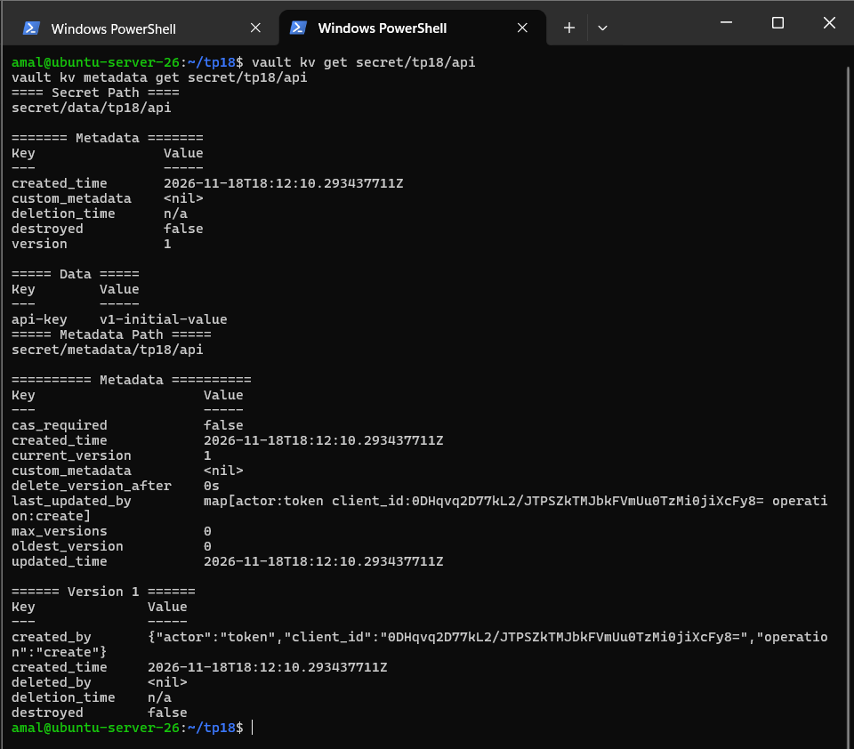
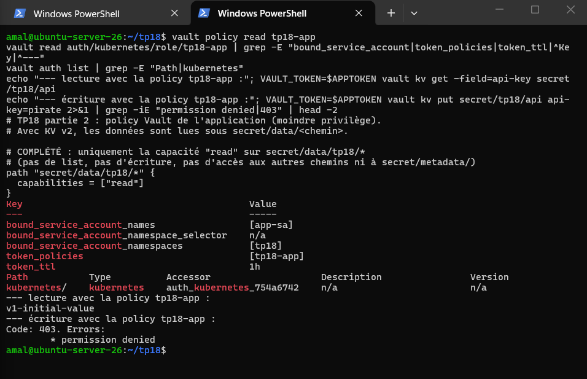
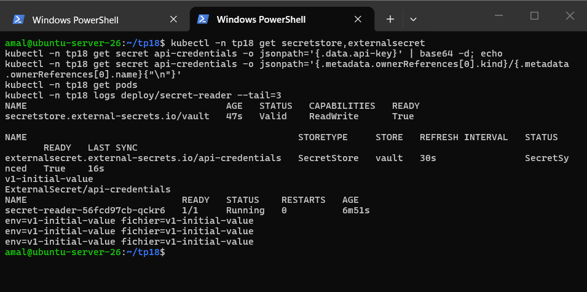
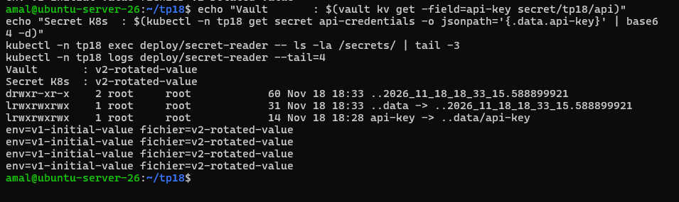
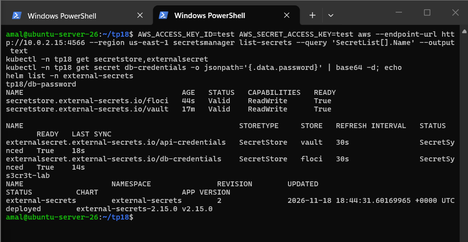
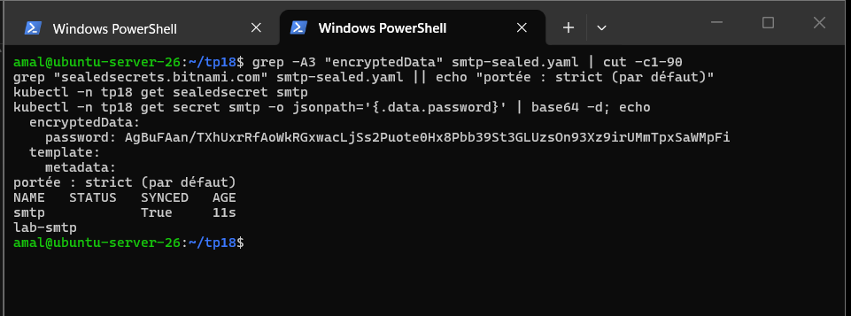

# TP18 : Gestion des secrets (Vault, External Secrets Operator, Sealed Secrets, rotation)

> **Cours** : DevOps & Cloud, M. Wahid ([énoncé](https://docs.teknolabs.net/courses/devops-cloud/partie-6-securite-plateforme/tp18-secrets-vault/))
> **Étudiante** : Amal Jemli, Master DevOps
> **Objectif** : un Secret Kubernetes n'est que du base64. Il faut donc centraliser les secrets dans **Vault** et les synchroniser avec **External Secrets Operator** (y compris depuis AWS Secrets Manager émulé par **Floci**), les chiffrer pour Git avec **Sealed Secrets**, et observer l'effet d'une **rotation**.

## Sommaire
1. [Environnement](#1-environnement)
2. [Partie 1 : Vault et KV v2](#2-partie-1--vault-et-kv-v2)
3. [Partie 2 : policies et authentification Kubernetes](#3-partie-2--policies-et-authentification-kubernetes)
4. [Partie 3 : External Secrets Operator](#4-partie-3--external-secrets-operator)
5. [Partie 4 : rotation](#5-partie-4--rotation)
6. [Partie 5 : Secrets Manager (Floci)](#6-partie-5--secrets-manager-floci)
7. [Partie 6 : Sealed Secrets](#7-partie-6--sealed-secrets)
8. [Partie 7 : synthèse](#8-partie-7--synthèse)
9. [Difficultés rencontrées](#9-difficultés-rencontrées)
10. [Sécurité](#10-sécurité)
11. [Livrables](#11-livrables)

---

## 1. Environnement

| Élément | Valeur |
|---|---|
| Cluster | K3s v1.34.12+k3s1, mono-nœud sur la VM de lab (9,2 Go de RAM) |
| Nettoyage préalable | Falco, Trivy Operator, Kyverno et le namespace `tp17` désinstallés (TP17 terminé). Kyverno en `Enforce` aurait bloqué `secret-reader` (busybox en root) |
| Floci | émulateur AWS du TP13, joignable depuis le cluster sur `http://10.0.2.15:4566` |

| Fichier | Rôle |
|---|---|
| `manifests/00-app.yaml` | namespace `tp18`, ServiceAccount `app-sa`, Deployment `secret-reader` (affiche le secret en variable **et** en fichier) |
| `vault/app-policy.hcl` | policy Vault en lecture seule sur `secret/data/tp18/*` (TODO complété) |
| `manifests/10-secretstore.yaml` | SecretStore Vault, authentification Kubernetes, rôle `tp18-app` (TODO complété) |
| `manifests/20-externalsecret.yaml` | ExternalSecret `tp18/api` → Secret `api-credentials` (TODO complétés) |
| `manifests/30-secretstore-floci.yaml` | SecretStore AWS Secrets Manager (Floci) |
| `manifests/40-externalsecret-floci.yaml` | ExternalSecret `tp18/db-password` → Secret `db-credentials` |
| `smtp-sealed.yaml` | SealedSecret chiffré (commitable) |

## 2. Partie 1 : Vault et KV v2

```bash
sudo apt-get install -y vault          # CLI Vault 2.2.2 (dépôt APT HashiCorp, déjà configuré pour Terraform)
helm repo add hashicorp https://helm.releases.hashicorp.com --force-update
VV=$(helm search repo hashicorp/vault -o json | jq -r '.[] | select(.name=="hashicorp/vault") | .version')   # 0.34.1, figée
helm install vault hashicorp/vault -n vault --create-namespace --version $VV \
  --set server.dev.enabled=true --set server.dev.devRootToken=root --set injector.enabled=false --wait
kubectl -n vault wait --for=condition=Ready pod/vault-0 --timeout=10m
kubectl -n vault port-forward svc/vault 8200:8200 > /tmp/pf-vault.log 2>&1 &
export VAULT_ADDR=http://127.0.0.1:8200 VAULT_TOKEN=root
vault kv put secret/tp18/api api-key=v1-initial-value
```



**Analyse**
- Avec KV v2, le chemin logique `secret/tp18/api` correspond à deux chemins d'API : **`secret/data/tp18/api`** (les valeurs) et **`secret/metadata/tp18/api`** (l'historique). Les policies doivent viser `secret/data/…` (partie 2).
- `version 1`, `current_version 1` : **chaque écriture crée une nouvelle version**, les anciennes restent consultables et restaurables (`vault kv rollback`). Une suppression (`delete`) est réversible (`undelete`) ; seul `destroy` efface définitivement une version.
- `max_versions 0` signifie la valeur par défaut du moteur, soit **10 versions** conservées.
- `created_by` / `last_updated_by` : Vault enregistre **qui** a écrit (`actor: token`, identifiant de client). C'est une base pour l'**audit**, qu'un Secret Kubernetes ne fournit pas. En production, on active en plus un *audit device* (`vault audit enable file …`).
- **Mode dev = lab uniquement** : stockage en mémoire (tout est perdu au redémarrage du Pod), Vault déjà descellé, jeton root `root` connu. En production, Vault démarre **scellé** (clés Shamir ou *auto-unseal* KMS), avec un stockage persistant (Raft) et TLS ; le jeton root est révoqué après l'initialisation.

## 3. Partie 2 : policies et authentification Kubernetes

```hcl
# vault/app-policy.hcl (TODO complété)
path "secret/data/tp18/*" {
  capabilities = ["read"]
}
```

```bash
vault policy write tp18-app vault/app-policy.hcl
vault auth enable kubernetes
vault write auth/kubernetes/config kubernetes_host="https://kubernetes.default.svc:443"
vault write auth/kubernetes/role/tp18-app bound_service_account_names=app-sa \
  bound_service_account_namespaces=tp18 policies=tp18-app ttl=1h
# preuve du moindre privilège : jeton temporaire portant seulement la policy tp18-app (jamais affiché)
APPTOKEN=$(vault token create -policy=tp18-app -ttl=5m -field=token)
VAULT_TOKEN=$APPTOKEN vault kv get -field=api-key secret/tp18/api           # OK
VAULT_TOKEN=$APPTOKEN vault kv put secret/tp18/api api-key=pirate           # 403
unset APPTOKEN
```



**Analyse**
- La policy `tp18-app` n'accorde que **`read`** sur `secret/data/tp18/*`. Tout le reste est **refusé par défaut** dans Vault : écriture, `list`, `secret/metadata/…`, autres chemins.
- **Preuve** : avec un jeton qui porte seulement cette policy, la **lecture** renvoie `v1-initial-value`, alors que l'**écriture** échoue avec **`Code: 403 … permission denied`**.
- Méthode d'authentification `kubernetes/` activée. Fonctionnement : le Pod présente le **jeton de son ServiceAccount** (JWT signé par Kubernetes) ; Vault le fait vérifier par l'API Kubernetes (**TokenReview**, possible grâce au ClusterRoleBinding `system:auth-delegator` créé par le chart Vault) ; si le ServiceAccount et le namespace correspondent au rôle, Vault délivre **son propre jeton**, limité à la policy `tp18-app` et valable **1 h** (`token_ttl`).

**Question : quel Pod peut obtenir un jeton Vault avec ce rôle ?** Uniquement un Pod qui s'exécute avec le ServiceAccount **`app-sa`** dans le namespace **`tp18`** (`bound_service_account_names=[app-sa]` **et** `bound_service_account_namespaces=[tp18]`). Le jeton obtenu ne permet que de **lire** `secret/data/tp18/*`, pendant 1 h, renouvelable.

**Et un Pod d'un autre namespace ?** Même s'il crée un ServiceAccount qui s'appelle aussi `app-sa`, son jeton porte un autre namespace (`system:serviceaccount:<autre>:app-sa`). Vault **refuse la connexion** (`permission denied` / *service account namespace not authorized*). Il en va de même pour un autre ServiceAccount de `tp18`. Il n'y a **aucun secret partagé à distribuer** : l'identité du Pod suffit. C'est l'intérêt de la méthode Kubernetes par rapport à un jeton Vault statique stocké dans un Secret.

## 4. Partie 3 : External Secrets Operator

```yaml
# 10-secretstore.yaml (TODO)             # 20-externalsecret.yaml (TODO)
auth:                                    data:
  kubernetes:                              - secretKey: api-key
    mountPath: "kubernetes"                  remoteRef:
    role: "tp18-app"                           key: "tp18/api"
    serviceAccountRef: { name: "app-sa" }      property: "api-key"
```

```bash
helm repo add external-secrets https://charts.external-secrets.io --force-update
EV=$(helm search repo external-secrets/external-secrets -o json | jq -r '.[] | select(.name=="external-secrets/external-secrets") | .version')   # 2.15.0
helm install external-secrets external-secrets/external-secrets -n external-secrets --create-namespace --version $EV --wait --timeout 15m
kubectl api-resources | grep -E "^(secretstores|externalsecrets) "     # external-secrets.io/v1
kubectl apply -f manifests/00-app.yaml                                 # Pod bloqué : le Secret n'existe pas encore
kubectl apply -f manifests/10-secretstore.yaml -f manifests/20-externalsecret.yaml
```



**Analyse**
- **SecretStore `vault` : `Valid`, `READY True`** (*store validated*). ESO s'est authentifié auprès de Vault **avec l'identité du ServiceAccount `app-sa`** (TokenRequest), par le rôle `tp18-app` de la partie 2. Aucun jeton Vault n'est stocké dans le cluster.
- **ExternalSecret `api-credentials` : `SecretSynced`, `READY True`**, rafraîchi toutes les **30 s**. Le Secret Kubernetes `api-credentials` contient `v1-initial-value` et appartient à `ExternalSecret/api-credentials` (`ownerReferences`, `creationPolicy: Owner`) : s'il est supprimé ou modifié à la main, ESO le recrée ou le corrige ; si l'ExternalSecret est supprimé, le Secret l'est aussi.
- Le Pod `secret-reader`, bloqué en `ContainerCreating` tant que le Secret n'existait pas, a démarré tout seul : `env=v1-initial-value fichier=v1-initial-value`.
- **Vault reste la source de vérité** : on ne commite plus de valeur, seulement la **référence** (`tp18/api` / `api-key`). Les manifests ESO ne contiennent aucun secret et peuvent aller dans Git.
- L'événement `UpdateFailed … could not get secret data from provider` est apparu juste avant `secret created` : c'est la première tentative, pendant la validation du SecretStore. La synchronisation suivante a réussi.

## 5. Partie 4 : rotation

```bash
vault kv put secret/tp18/api api-key=v2-rotated-value      # rotation dans la source de vérité
# ~30 s : ESO met à jour le Secret ; ~1 à 2 min de plus : le kubelet met à jour le volume
kubectl -n tp18 logs deploy/secret-reader --tail=4
```



| Où | Valeur après rotation | Mise à jour |
|---|---|---|
| Vault (`secret/tp18/api`) | `v2-rotated-value` | immédiate (version 2) |
| Secret Kubernetes `api-credentials` | `v2-rotated-value` | ESO, au prochain `refreshInterval` (30 s) |
| **Fichier monté** `/secrets/api-key` | **`v2-rotated-value`** | kubelet, après 1 à 2 min (synchronisation périodique et cache) |
| **Variable d'environnement** `API_KEY` | **`v1-initial-value`** | **jamais** pour un conteneur déjà démarré |

- **Le fichier change, la variable d'environnement non** : `env=v1-initial-value fichier=v2-rotated-value`. Les variables d'environnement sont copiées **une fois, au démarrage du processus** ; seul un redémarrage du Pod les met à jour. Les volumes Secret sont, eux, resynchronisés par le kubelet.
- Mise à jour **atomique** du volume : le kubelet écrit la nouvelle version dans un dossier horodaté (`..2026_11_18_18_33_15…`) puis bascule le lien symbolique `..data`. `api-key -> ..data/api-key` change donc d'un coup, sans fichier à moitié écrit. Exception : un montage avec `subPath` n'est **jamais** mis à jour.
- Bonne pratique : **lire les secrets depuis des fichiers** et les relire à chaque usage (ou surveiller leur modification), plutôt que de les passer en variables d'environnement, qui fuient aussi plus facilement (`/proc/<pid>/environ`, journaux de crash, `kubectl describe`).
- Premier essai trop tôt : 90 s après la rotation, le Secret était déjà à jour mais le fichier pas encore. Il a fallu environ 2 min de plus. Ce délai est normal, il est réglé par `syncFrequency` et le cache des Secrets du kubelet.

**Redémarrage automatique** (pour que la variable prenne la nouvelle valeur) :
```bash
kubectl -n tp18 rollout restart deploy/secret-reader     # 1) déclenché par la CI après une rotation
```
2) ou l'opérateur **Reloader** (Stakater), avec l'annotation `reloader.stakater.com/auto: "true"` sur le Deployment : il détecte la modification du Secret `api-credentials` et lance lui-même un `rollout restart`. La rotation se fait alors de bout en bout sans intervention : Vault → ESO → Secret → Reloader → nouveaux Pods.

**Retour à la version 1** :
```text
$ vault kv rollback -version=1 secret/tp18/api
version            3
$ vault kv metadata get secret/tp18/api
current_version    3
====== Version 1 ======   ====== Version 2 ======   ====== Version 3 ======
$ vault kv get -field=api-key secret/tp18/api
v1-initial-value
```
**Que montre `vault kv metadata get` ?** Le rollback **ne supprime pas** la version 2 et ne revient pas en arrière dans l'historique : il **crée une nouvelle version 3**, copie des données de la version 1. `current_version` passe à **3**, et les trois versions restent visibles. L'historique est donc **conservé et auditable** (on sait qu'il y a eu une rotation puis un retour arrière), et on peut encore revenir à la version 2. ESO resynchronise ensuite `v1-initial-value` dans le Secret Kubernetes.

**Contre-épreuve** : le Pod redémarré **avant** le rollback (quand Vault valait `v2`) affiche ensuite `env=v2-rotated-value fichier=v1-initial-value`. La variable reste figée à la valeur lue **au démarrage**, alors que le fichier suit Vault (rollback vers v1). C'est la même règle, observée dans l'autre sens.

## 6. Partie 5 : Secrets Manager (Floci)

```bash
docker start floci && docker port floci                       # 4566/tcp -> 0.0.0.0:4566 (joignable depuis les Pods)
AWS_ACCESS_KEY_ID=test AWS_SECRET_ACCESS_KEY=test aws --endpoint-url http://10.0.2.15:4566 --region us-east-1 \
  secretsmanager create-secret --name tp18/db-password --secret-string 's3cr3t-lab'
# identifiants FICTIFS de l'émulateur, créés en ligne de commande (pas dans Git)
kubectl -n tp18 create secret generic floci-creds --from-literal=access-key=test --from-literal=secret-access-key=test
# endpoint personnalisé pour le fournisseur AWS d'ESO
helm upgrade external-secrets external-secrets/external-secrets -n external-secrets --version 2.15.0 --reuse-values \
  --set "extraEnv[0].name=AWS_SECRETSMANAGER_ENDPOINT" --set "extraEnv[0].value=http://10.0.2.15:4566" --wait
kubectl apply -f manifests/30-secretstore-floci.yaml -f manifests/40-externalsecret-floci.yaml
```



**Analyse**
- Le secret `tp18/db-password` existe dans **Secrets Manager (Floci)**. Le SecretStore `floci` (fournisseur `aws`, service `SecretsManager`, `us-east-1`, authentification par `secretRef`) est **`Valid`**, et l'ExternalSecret `db-credentials` est **`SecretSynced`**. Le Secret Kubernetes contient `s3cr3t-lab`.
- **Deux sources en parallèle** dans le même namespace : `api-credentials` ← **Vault**, `db-credentials` ← **AWS Secrets Manager**. ESO présente une **interface unique** (le Secret Kubernetes) quel que soit le coffre, ce qui permet de changer de fournisseur (Vault, AWS, GCP, Azure…) sans toucher à l'application.
- L'**endpoint** est fourni au contrôleur par la variable `AWS_SECRETSMANAGER_ENDPOINT` (fonction *custom endpoints* d'ESO). Sur le vrai AWS, cette variable est inutile.
- Le `helm upgrade` (révision 2) a remis la release en état **`deployed`** (elle était en `failed` après l'installation, à cause du `--wait` dépassé).
- En production sur AWS, on n'utiliserait pas de clés statiques dans un Secret, mais **IRSA / EKS Pod Identity** (rôle IAM attaché au ServiceAccount d'ESO), sur le même principe que l'authentification Kubernetes de Vault : **une identité, pas un secret pour lire les secrets**.

## 7. Partie 6 : Sealed Secrets

> Le dépôt Helm de l'énoncé (`https://bitnami-labs.github.io/sealed-secrets`) renvoie **404** : le projet a migré vers **`https://bitnami.github.io/sealed-secrets`** et le code source vers **`github.com/bitnami/sealed-secrets`**.

```bash
helm repo add sealed-secrets https://bitnami.github.io/sealed-secrets
read SV SA < <(helm search repo sealed-secrets/sealed-secrets -o json | jq -r '.[] | select(.name=="sealed-secrets/sealed-secrets") | "\(.version) \(.app_version)"')
helm install sealed-secrets sealed-secrets/sealed-secrets -n kube-system --version $SV --wait     # chart 2.22.0, contrôleur 0.41.2
# CLI kubeseal dans la MÊME version, empreinte SHA256 vérifiée
KV=${SA#v}
curl -fLO https://github.com/bitnami/sealed-secrets/releases/download/v$KV/kubeseal-$KV-linux-amd64.tar.gz
curl -fLO https://github.com/bitnami/sealed-secrets/releases/download/v$KV/sealed-secrets_${KV}_checksums.txt
grep "kubeseal-$KV-linux-amd64.tar.gz" sealed-secrets_${KV}_checksums.txt | sha256sum -c -        # OK
# chiffrement sans jamais appliquer le Secret en clair (--dry-run)
kubectl -n tp18 create secret generic smtp --from-literal=password='lab-smtp' --dry-run=client -o yaml \
  | kubeseal --controller-name sealed-secrets --controller-namespace kube-system -o yaml > smtp-sealed.yaml
kubectl apply -f smtp-sealed.yaml
```



**Analyse**
- Dans `smtp-sealed.yaml`, la valeur n'apparaît plus : `encryptedData.password: AgBuFAan/TXhUxr…`. Elle est **chiffrée avec la clé publique** du contrôleur (chiffrement hybride RSA-OAEP + AES-GCM). Ce fichier peut être **commité dans Git** : il est fourni dans le dépôt (`smtp-sealed.yaml`).
- `kubectl apply` du **SealedSecret** → le contrôleur, seul détenteur de la **clé privée**, le déchiffre et crée le **Secret** `smtp` (`SYNCED True`), dont la valeur est bien `lab-smtp`.
- Le Secret en clair n'a **jamais** été envoyé au cluster ni écrit sur disque : `--dry-run=client` le génère en mémoire et le passe directement à `kubeseal`.
- **Portée `strict`** (par défaut, aucune annotation `sealedsecrets.bitnami.com/*-wide`) : le **nom** et le **namespace** (`smtp` / `tp18`) font partie des données authentifiées du chiffrement.

## 8. Partie 7 : synthèse
> ⏳

## 9. Difficultés rencontrées

| Problème | Cause | Solution |
|---|---|---|
| `helm list` : ESO en `failed`, webhook et cert-controller en `0/1` | Démarrage lent du cert-controller (génération des certificats du webhook), délai `--wait` dépassé sur une connexion lente | Le contrôleur principal fonctionnait : synchronisation OK. Release remise en état `deployed` par le `helm upgrade` de la partie 5 |
| `helm repo add sealed-secrets https://bitnami-labs.github.io/sealed-secrets` → **404** | Le projet a migré de `bitnami-labs` vers `bitnami` | Nouveau dépôt `https://bitnami.github.io/sealed-secrets` et releases `github.com/bitnami/sealed-secrets` |
| Port-forward arrêté (`Exit 1`), puis `connection refused` sur `vault status` | `port-forward` lancé alors que `vault-0` était encore en `ContainerCreating` | `kubectl -n vault wait --for=condition=Ready pod/vault-0`, puis relance du port-forward et vérification du log |

## 10. Sécurité
> ⏳

## 11. Livrables

| Capture | Contenu | État |
|---|---|---|
| `captures/vault-kv.png` | `vault kv get` et `vault kv metadata get` (versions) | ✅ |
| `captures/vault-k8s-auth.png` | Rôle Kubernetes et policy `tp18-app` | ✅ |
| `captures/eso-synced.png` | ExternalSecret en état `SecretSynced` | ✅ |
| `captures/rotation.png` | Logs : le fichier change, la variable d'environnement non | ✅ |
| `captures/eso-floci.png` | Secret synchronisé depuis Secrets Manager (Floci) | ✅ |
| `captures/sealed-secret.png` | SealedSecret chiffré et Secret déchiffré dans le cluster | ✅ |
